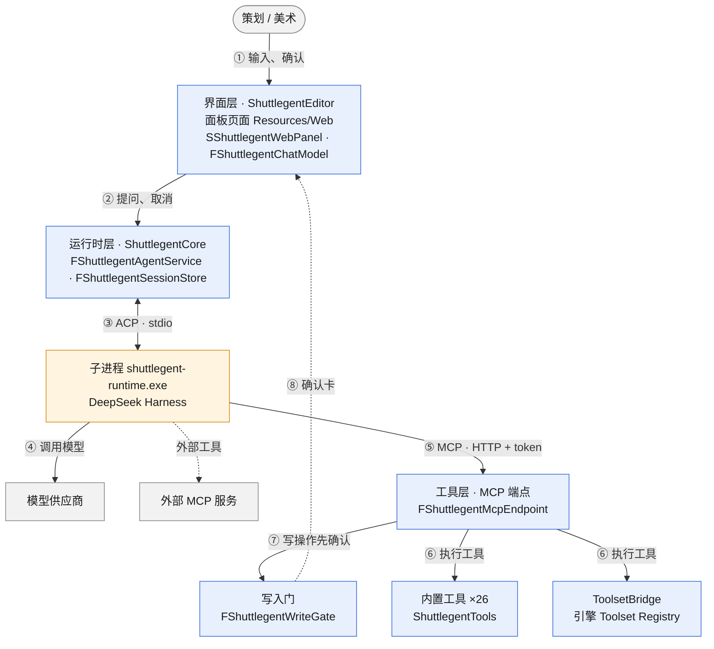
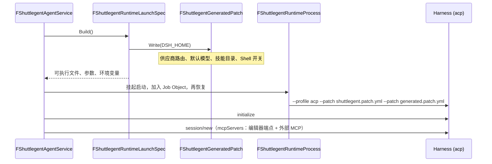
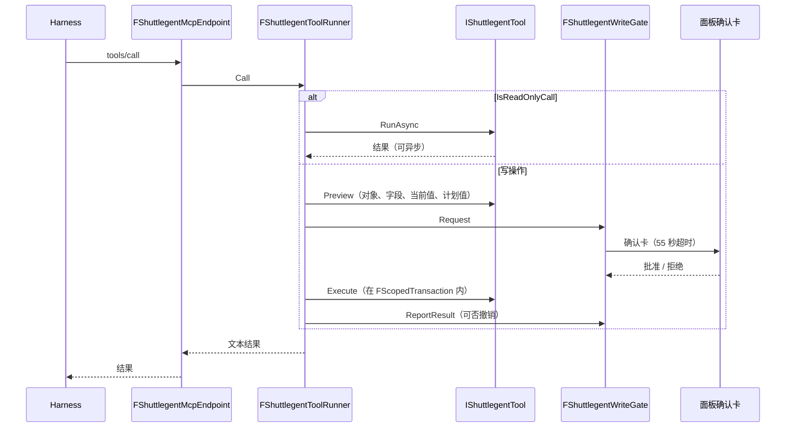
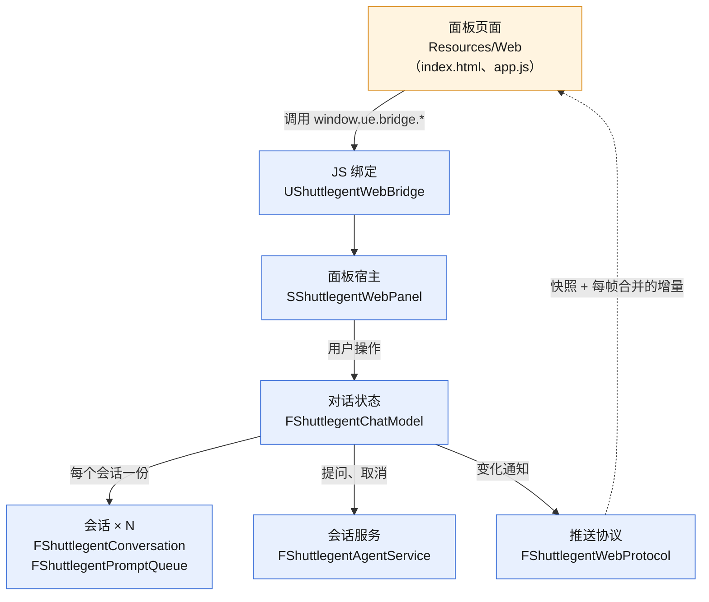

# 架构

本文说明 Shuttlegent 的组成、各部分的职责与主要流程。文中路径相对插件根目录。

## 1. 总览

Shuttlegent 由编辑器内的五个模块和一个运行时子进程组成：

- **编辑器侧**：负责对话界面、会话记录、编辑器工具与写操作确认。
- **运行时**：即 [DeepSeek Harness](https://github.com/deepseek-ai/deepseek-harness)（下称 Harness）。负责 Agent 循环、上下文管理与模型调用。

两者之间有两条通道：

- **[ACP](https://github.com/agentclientprotocol/agent-client-protocol)（Agent Client Protocol）**：编辑器作为 ACP 客户端，经子进程的 stdio 驱动 Agent。
- **MCP（Model Context Protocol）**：Agent 作为 MCP 客户端，调用编辑器内只对本机开放的 MCP 端点上的编辑器工具。

图例：蓝色为编辑器进程内的插件模块，橙色为运行时子进程，灰色为用户与外部服务；虚线为可选或回传路径。写操作先经 ⑦⑧ 在面板确认，确认后再走 ⑥ 执行。

| 层 | 模块 | 职责 |
|---|---|---|
| 运行时层 | `ShuttlegentCore` | 设置、生成运行时补丁、解析密钥、启动运行时、ACP 会话、会话记录 |
| 工具层 | `ShuttlegentMcpServer` | MCP 端点、写入门、工具注册接口 `IShuttlegentToolProvider`、外部 MCP 声明 |
| 工具层 | `ShuttlegentTools` | 17 个内置编辑器工具 |
| 工具层 | `ShuttlegentToolsetBridge` | 接入引擎 Toolset Registry |
| 界面层 | `ShuttlegentEditor` | 对话面板、对话状态、引用、斜杠模板与内置斜杠命令、设置页定制；在 `PostEngineInit` 阶段加载 |

三条约束：

- 与运行时的所有通信都经过 `FShuttlegentAgentService`。
- 所有编辑器写操作都经过 `FShuttlegentWriteGate`，工具不能绕过它直接修改编辑器状态。
- 所有编辑器工具都通过 `IShuttlegentToolProvider` 注册到 MCP 端点；引擎 Toolset 只经 `ShuttlegentToolsetBridge` 接入。

## 2. 运行时与 ACP

### 2.1 运行时

`Runtime/shuttlegent-runtime.exe` 是用 `Build/BuildRuntime.ps1` 把 Harness 子模块打包成的单文件程序（Node SEA）。打包的好处：

- 用户不用装 Node；
- Node 与依赖的版本固定；
- 编辑器只需管理一个进程。

Harness 内部是插件化的：ACP 服务、Agent 核心、模型对接各是独立的插件，启动时按配置组装。`--profile acp` 选择“基础插件 + ACP 服务”这套组合。

### 2.2 启动

- **启动目录与 `DSH_HOME`**：`%LOCALAPPDATA%/Shuttlegent/dsh-home`。必须在系统盘，否则打包后的运行时加载原生模块失败。
- **进程管理**：先挂起启动，再加入关闭即终止的 Job Object，然后恢复，保证运行时及其子进程不会比编辑器活得久。
- **环境变量**：只继承必要的系统变量，再加上：
  - `DSH_HOME`、`DSH_AGENTS_HOME`；
  - `DSH_PERMISSION_MODE`（`read-only` 或 `workspace-write`）；
  - `DSH_TELEMETRY_DISABLED`；
  - 各供应商的密钥变量；
  - `SHUTTLEGENT_EDITOR_ENDPOINT`、`SHUTTLEGENT_EDITOR_TOKEN`：编辑器端点的 URL 与本次启动新生成的 token，只供插件自带的运行时插件使用（`FShuttlegentAgentService::RuntimeEnvironmentProvider`，由 `ShuttlegentMcpServer` 在启动前填入；token 每次启动运行时轮换）。
- **补丁**：
  - `Runtime/profile/shuttlegent.patch.yml`：固定的插件补丁。关闭 Shell、后台作业工具（`tool-jobs`，随 Shell 开关由生成的补丁一同打开）、切换工作目录工具（`tool-working-directory`，会把文件工具带出项目）、子任务工具（`tool-subagent`、`tool-subagent-fork`、`tool-subagent-control`、`tool-subagent-list-agents`：ACP 按会话声明编辑器端点，子会话拿不到编辑器工具，派出去的编辑器任务只会失败；回归场景 `s17_subagent`）、workflow、遥测；项目提示词只读 `SHUTTLEGENT.md`；技能只来自配置的目录；人设改为“UE 编辑器内助手”。
  - `generated.patch.yml`：每次启动前写入 `DSH_HOME`，包含用户的 DeepSeek 端点、自定义路由、默认模型、项目技能目录、Shell 开关，以及以绝对路径插入的插件自带运行时插件（见下）。补丁里不写密钥。
- **插件自带的运行时插件**（`Runtime/plugins/`，不改 Harness 源码）：
  - `shuttlegent-context-tap.mjs`：每条助手消息之后（与 `usage_update` 同一时机）读取 Harness 的 `contextBreakdown` 投影（系统提示、工具定义、消息三项估算），以 JSON-RPC 通知 `shuttlegent/contextBreakdown` 发到编辑器端点；端点交给 `FShuttlegentMcpServerModule::OnContextBreakdown()`，对话模型按会话保存后推给面板。发送失败只记一次警告，不影响对话。⚠️ 依赖 Harness 的 `session/event` 事件与 `sessionProjections` 服务，二者不是稳定接口，升级 Harness 后需用回归场景 `s14_context` 复查。
  - `shuttlegent-session-control.mjs`：供“回到这里”和“分支”截断会话。ACP 没有截断或分叉会话的方法，插件在本机开一个只认当前 token 的端口，加载后以通知 `shuttlegent/runtimeControl` 把 URL 报给编辑器端点（`FShuttlegentMcpServerModule::CanForkSessions()`）。编辑器调用其 `fork`（会话 ID、第几条用户消息、截在该消息之前或该轮结束之后），插件把源会话的事件截到该处，经 `sessionPersistence` 另存为一个**不带 `parentSession` 的普通会话**（Harness 自带的 `Sessions.fork` 会写入 `parentSession`，ACP 的 `session/resume` 拒绝这类会话），编辑器再用 `session/resume` 接入。用户消息只数 `source.kind` 为 `user` 的 `user/message`（运行时自己注入的运行时上下文、system-reminder 也记为 `user/message`，来源不同），与面板的用户条目一一对应；截在某条消息之前时，连同把它放进收件箱的 `agent/inbox/spliced` 一起排除，否则接入后会重新执行这条消息。复制的 `session-log-deepseek/delivery-accepted` 标记记着源会话 ID，原样复制会被存储校验判为损坏（“current-generation delivery marker names the wrong Session”），因此改标为旧格式代次，校验与 DeepSeek 投递都忽略它，新会话首次请求时重新投递完整记录。⚠️ 依赖 Harness 的 `sessions`、`sessionPersistence` 服务与事件类型名，升级后需用回归场景 `s15_fork` 复查。
    - 同一端口另有三个方法（`FShuttlegentMcpServerModule` 的同名函数调用，经共用的 `CallRuntimeControl`）：
      - `command`：执行一条斜杠命令（`ctx.commands.execute`，与 Harness 网页客户端相同），如 `/compact`、`/plan`。ACP 的 `session/prompt` 不解析斜杠命令，会把它当普通文字发给模型，因此命令只能走这里（`RunCommand`，超时 600 秒，`/compact` 要调用模型生成摘要）。
      - `planMode`：进入或退出计划模式（`ctx.planMode.set`），不带 `active` 时只查询；回合进行中时在下一步生效（`SetPlanMode`）。
      - `answerPlanReview`：答复计划审批（`AnswerPlanReview`）。计划模式下模型调用 `exit_plan_mode` 后，Harness 经“用户提问”通道（`user-questions/request`）请用户批准，ACP 下没有任何应答方，原本直接报 `NO_PROVIDER`。插件接管其中 `intent.kind` 为 `plan-review` 的请求，以通知 `shuttlegent/planReview`（会话 ID、审批 ID、计划正文）交给编辑器，等编辑器答复批准或“继续规划 + 意见”；回合取消时发 `shuttlegent/planReviewClosed`。编辑器没有订阅 `OnPlanReview()` 时，模块直接以“不可用”退回，回合不会卡住；对话模型订阅后，交出计划的会话不在面板中时同样退回。
    - ⚠️ Harness 的计划模式只在提示词里加一段说明，**不限制工具**（`ThirdParty/deepseek-harness/packages/plan/plan-mode/src/index.ts:1-19`）；“只读”须由编辑器侧保证。
  - `shuttlegent-session-tap.mjs`：把 ACP 不转发的会话事件逐条按顺序以通知 `shuttlegent/sessionEvent`（会话 ID、类型、精简后的数据）发到编辑器端点，交给 `FShuttlegentMcpServerModule::OnSessionEvent()`（`FShuttlegentSessionEvent`）：

    | 事件 | 数据 |
    |---|---|
    | `todo/write` | 完整待办列表，每项 `content`、`status`（`pending`、`in_progress`、`completed`）；每次替换上一份 |
    | `plan/mode` | `active` |
    | `compaction/start`、`compaction/summary`、`compaction/end`、`compaction/prune` | `manual`（手动压缩）、`shadowedTokenCount`（被压缩掉的 token）、`error`；`compaction/end` 另带压缩后的上下文用量 `usedTokens` |
    | `goal/change` | `operation`、`objective`、`phase` |

    ⚠️ 依赖 Harness 的事件类型名与数据结构，升级后需用回归场景 `s16_session_tap` 复查。
- **密钥**：只来自编辑器偏好设置，以环境变量交给运行时。内置路由用 `DEEPSEEK_API_KEY`，自定义路由用 `SHUTTLEGENT_<ROUTE>_API_KEY`。

### 2.3 会话

- `FShuttlegentAcpConnection`：基于 stdio 的 JSON-RPC 2.0，一行一条消息，回调都在游戏线程。
- `FShuttlegentAgentService`：可同时打开并驱动多个会话；一个会话的回合结束后，迟到的更新会被丢弃。
- 使用的 ACP 方法：`initialize`、`session/new`、`session/resume`、`session/close`、`session/prompt`、`session/cancel`、`session/set_config_option`（模型、思考强度）、`session/request_permission`。
- 处理的 `session/update` 类型：`agent_message_chunk`、`agent_thought_chunk`、`tool_call`、`tool_call_update`、`usage_update`。
- `FShuttlegentSessionStore`：运行时不支持 `session/load` 回放，所以每次提问、每条更新和每个回合结束都由插件追加到项目 `Saved/Shuttlegent/Sessions` 下的 JSONL 记录。重新打开会话时，由面板回放这些记录。

Harness 的 ACP 实现只暴露标准 ACP 的最小子集，待办、计划、命令、模式、上下文压缩、子任务进度和向用户提问都不经 ACP 传递。插件以 `shuttlegent-session-tap`、`shuttlegent-session-control` 两个运行时插件补上（见 §2.2）；面板已接入待办、压缩、计划模式与内置斜杠命令（见 §4）。子任务不需要接入：插件补丁关闭了子任务工具（见 §2.2），因为子会话拿不到编辑器端点。

## 3. 编辑器工具

### 3.1 MCP 端点

- `FShuttlegentMcpEndpoint`：只监听本机的 Streamable HTTP 端点，以普通 JSON 应答，不用 SSE。
  - 端口从 47800 起，在 100 个端口内找第一个空闲的。
  - 请求必须带 bearer token；token 在每次运行时启动时更换，通过 ACP 的 `mcpServers` 声明交给运行时。
  - 在运行时一侧，服务名为 `ue`。
- `FShuttlegentToolRegistry`：每次收到 `tools/list` 时，向所有工具提供者重新收集工具。
- 单次工具输出上限 24,000 字符，超出部分截断并提示模型缩小查询。

### 3.2 执行与写入门

写操作的规则：

- 任一对象失败时，整个事务回滚；
- 事务没有记下改动时，标为不可撤销；
- 面板未打开时，写请求直接拒绝；
- 确认超时 55 秒，短于运行时 60 秒的工具超时。

工具清单与引擎 Toolset 规则见 [Tools.md](Tools.md)。

## 4. 对话面板

- 面板是一个 Dock 页签（`ShuttlegentChat`），页面在 CEF 中加载。页签关闭后再打开，状态仍然保留。
- `FShuttlegentWebProtocol`：页面就绪时推送完整快照，此后只推增量；同一帧内的变化合并成一条消息。
- 布局：顶栏横跨对话区与检视窗格、通到面板右边缘，检视窗格开关固定在顶栏右端（打开时显示按下底色）；检视窗格位于顶栏下方，打开时把对话内容往左挤，窄宽度下改为浮层，同样位于顶栏下方。对话区的滚动容器横跨整个顶栏下方区域，滚动条贴在面板最右边缘、上下通到底，输入框浮在对话底部；停靠的检视窗格叠在对话区右侧、滚动条左边，对话内容按 `--inspector-space` 让出它的宽度。检视窗格自己的滚动条只在鼠标移入时显示。空白会话时输入框同样在底部，大标志居中于其上方的区域；输入框下方不再显示按键提示，暂不能发送的原因（排队、运行时未启动等）改写在输入框的占位文字里。
- 用户消息：鼠标悬停或键盘焦点在消息上时，下方右对齐显示一行（照 Claude）：相对时间（悬停显示完整时间）、复制、回到这里、分支。
  - **复制**：复制消息原文（不含引用块）。
  - **分支**（`FShuttlegentChatModel::BranchFrom`）：运行时把会话截在该消息这一轮结束之后另存为新会话；面板会话记录复制到同一处，标题加“（分支）”并打开新会话。原会话与编辑器状态不变。
  - **回到这里**（`FShuttlegentChatModel::RewindTo`，页面先弹确认框，列出将撤销与不可撤销的修改数、将移除的消息数）：先确认这条消息之后可撤销写入的事务恰好依次占据撤销栈顶（`FShuttlegentWriteGate::AreOnUndoTop`），中间夹着用户自己的编辑时整体拒绝；再由运行时把会话截在该消息之前另存为新会话，成功后按倒序撤销这些写入，原会话归档，打开新会话并把消息原文放回输入框。不可撤销的写入（数据表加行、存盘等）保留在编辑器中。截断第一条消息时不需要运行时，撤销写入后开始新对话。
  - 两者都要求当前对话空闲、会话已在运行时打开、session control 插件可用（`CanEditHistory`）；不满足时按钮变灰，悬停提示原因。写入结果只保存在内存里，重新打开的旧会话回到某条消息时没有可撤销的写入。
- 任务清单：Agent 用 `todo_write` 列出的待办（`todo/write`，经 session tap 插件）显示在输入框上方，标题行为“任务 已完成数/总数”与进行中的一项，可折叠；进行中的一项加粗并转圈，已完成的打勾划线。每次 `todo/write` 给出完整列表，替换上一份；用户发出新提示时清空（与运行时在新回合清空 `todos` 投影一致）。回合结束且全部完成时自动折叠。只在内存中，不写入会话记录。
- 计划模式：输入框下方的“计划模式”开关（打开时输入框描边为蓝色）。打开后 Agent 只查看、出方案；编辑器写入门在计划模式的回合中拒绝一切写入（Harness 的计划模式只改提示词、不限制工具，只读由此保证；见 [Tools.md §1](Tools.md#1-写操作确认与撤销)）。会话创建前打开时先记下选择，会话就绪后先应用再发送第一条提示；恢复会话时查询运行时记录的状态。Agent 调用 `exit_plan_mode` 交出计划后，输入框位置换成审批卡片：显示计划（可点对象链接）、可填修改意见，“继续规划”把意见交回 Agent，“批准并执行”让 Agent 退出计划模式按计划执行（每次写入仍需确认）。审批不限时，Esc 不会退回计划。计划连同审批结果（待审批、已批准、已退回附意见、已取消）留在对话中（`EShuttlegentChatEntryKind::Plan`），并写入会话记录（`plan`）。回合取消或运行时退出时，等待中的审批标为已取消。计划模式提示词由插件补丁覆盖为编辑器场景的说法，提问改用 `ask_user`。
- 上下文压缩：压缩开始、结束（`compaction/*`）在对话中显示为一条虚线分隔行：“正在自动/手动压缩上下文…”“上下文已压缩 · 约 N tokens 转为摘要”或失败原因（`EShuttlegentChatEntryKind::Compaction`）。结束时用插件报来的压缩后用量更新上下文卡片，并把结果追加到会话记录（`compaction`），重新打开会话时回放。上下文卡片底部有“压缩上下文”按钮（`FShuttlegentChatModel::CompactContext`，经 `RunCommand` 执行 `/compact`），条件与“回到这里”相同（会话已打开、空闲、session control 插件可用），压缩期间显示“压缩中…”；没有可压缩的内容时以通知显示运行时的说明。
- 斜杠菜单与内置命令：行首输入 `/` 弹出菜单，“命令”分区在“模板”分区之前，均按输入过滤；选中只把文字填进输入框，已完整输入的命令选中即执行。整段输入以下列命令开头时，由页面在编辑器侧执行，不发给模型（`Resources/Web/app.js` 的 `runSlashCommand`）；其他以 `/` 开头的文字照常作为消息发送，同名模板仍可从菜单插入：

  | 命令 | 作用 | 复用 | 不可用时 |
  |---|---|---|---|
  | `/compact` | 压缩上下文，不带参数（与 Harness 一致） | 上下文卡片“压缩上下文”按钮 | `compactReason` |
  | `/plan`、`/plan off`、`/plan <消息>` | 进入、退出计划模式；带消息时进入后发送该消息（与 Harness 一致） | “计划模式”开关；带消息时 `SubmitDraft` 的 `bEnterPlanMode` | `planModeReason` |
  | `/undo` | 回退本轮：对最后一条用户消息打开“回到这里”确认框 | “回到这里” | `editHistoryReason`；没有用户消息时说明无可回退 |
  | `/clear` | 开始新对话，当前对话留在侧栏 | 新对话 | 始终可用 |

  命令不可用或参数不对时不执行，输入保留，原因显示在输入框下方一行（5 秒后或继续输入时消失）；菜单中不可用的命令置灰并以原因代替说明。`/plan <消息>`：计划模式走控制端口、提示走 ACP，两者没有先后保证，会话已打开时提示先挂起（对话随之忙碌，新草稿排队），运行时确认计划模式已开后再发出，切换失败则放回队列首位并暂停；会话未创建时沿用“就绪后先应用计划模式再发送”；回合进行中时计划模式在下一步生效，消息照常排队。
- 回答中的对象链接：运行时提示词（`Runtime/profile/shuttlegent.patch.yml`）要求 Agent 把已知路径的资产写成 `[名称](ue-asset:<对象路径>)`、Actor 写成 `[Actor 标签](ue-actor:<对象路径>)`；行内代码若是完整的 `/Game/...` 路径，也渲染成资产链接。包路径（无 `.`）补上对象名，同一资产的链接路径一致。
  - 单击：资产在内容浏览器中定位，Actor 在关卡中单独选中并把关卡编辑器页签切到前台、视口获得键盘焦点；双击：打开资产编辑器，或让视口镜头移到 Actor（`FShuttlegentReferenceNavigator`，经 `UShuttlegentWebBridge::RevealObject`）。只改选中与焦点，不产生事务，不影响“回到这里”。
  - 存在性：页面把对话中全部对象链接与草稿引用一起交给 `WatchReferences`，对象被删除或经撤销恢复后，链接随 `onReferenceValidity` 变灰（加删除线，悬停提示“对象已不存在”），点击不做任何操作。
  - Actor 只认 Agent 明确写出的链接，页面不按名称猜测，避免重名时选错对象。
  - 表格渲染为 HTML 表格，单元格内同样解析链接、行内代码与加粗（`Resources/Web/markdown.js` 的 `table`）；分隔行到达前（回答仍在流式输出）按等宽源码显示。
- 右侧检视窗格由四张可单独展开的卡片组成，折叠时标题行右侧显示摘要：

  | 卡片 | 摘要 | 展开内容 | 数据 |
  |---|---|---|---|
  | 上下文 | 已用百分比 | 已用与总量 tokens；分段用量条与图例：消息、工具定义、系统提示、剩余（分项按运行时估算的比例分摊实际用量，未收到分项时只显示“已用 / 剩余”）；当前模型与推理强度 | `usedTokens`、`contextSize` 来自 `usage_update`（只有总量）；`contextBreakdown` 来自运行时插件 `shuttlegent-context-tap`（见 §2.2）；`config` |
  | MCP | 下次会话可用的服务数 | 两行汇总：编辑器端点（是否监听、端口）与外部服务（已声明数、跳过数）；三组可展开明细：编辑器工具（读写与开关）、引擎 Toolset（工具数、屏蔽或关闭）、外部服务（已声明，或被跳过及原因） | `mcp`，快照时推送，个人或项目设置变化、每轮结束时重推；运行时不回报外部服务是否连上 |
  | 工具详情 | 调用次数与失败数 | 每次调用的参数与结果；点对话中的工具行时自动展开到该调用 | 对话条目 |
  | 日志 | 条数与警告数 | 运行日志 | `runLog` |

- `SShuttlegentWebPanel` 负责 CEF 管不了的部分：编辑器拖放、面板快捷键、面板自带的内容浏览器抽屉，以及用系统浏览器打开外部链接（只有 `http(s)` 链接交给系统浏览器，对象链接由页面拦截后经桥接处理）。

## 5. 类清单

路径相对 `Source/`。

| 模块 | 类 | 用途 |
|---|---|---|
| Core | `FShuttlegentAgentService` | 管理运行时与它打开的 ACP 会话 |
| Core | `FShuttlegentAcpConnection` | 基于运行时 stdio 的 JSON-RPC 2.0 连接 |
| Core | `FShuttlegentRuntimeProcess` | 运行时子进程：挂起启动、Job Object、stdio 读写线程 |
| Core | `FShuttlegentRuntimeLaunchSpec` | 组装启动所需的可执行文件、参数、环境与密钥 |
| Core | `FShuttlegentGeneratedPatch` | 每次启动前写入的第二个补丁 |
| Core | `FShuttlegentProjectConfig` / `FShuttlegentSecrets` | 读出生效配置 / 从偏好设置解析密钥 |
| Core | `FShuttlegentSessionStore` | 会话索引与 JSONL 记录 |
| Core | `FShuttlegentConsoleCommands` | `Shuttlegent.*` 控制台命令 |
| Core | `UShuttlegentSettings` / `UShuttlegentProjectSettings` | 个人设置 / 项目设置 |
| McpServer | `FShuttlegentMcpEndpoint` | 本机 MCP 端点 |
| McpServer | `FShuttlegentToolRegistry` / `FShuttlegentToolRunner` | 收集工具 / 执行一次工具调用 |
| McpServer | `FShuttlegentWriteGate` | 写操作确认门：排队、超时、结果上报、撤销 |
| McpServer | `FShuttlegentExternalMcp` | 把项目的外部 MCP 服务声明给运行时；同时给出每个服务的状态（`FShuttlegentExternalMcpState`，跳过原因为 `EShuttlegentExternalMcpIssue`），供面板 MCP 卡片显示 |
| McpServer | `IShuttlegentTool` / `IShuttlegentToolProvider` | 工具接口 / 工具提供者接口（扩展点） |
| Tools | `FShuttlegentBuiltinToolProvider` | 提供 26 个内置工具 |
| ToolsetBridge | `FShuttlegentToolsets` | 读取 Toolset Registry：可见性、工具列表、读写判断、执行 |
| Editor | `FShuttlegentChatModel` / `FShuttlegentConversation` | 对话状态 / 单个会话 |
| Editor | `SShuttlegentWebPanel` / `UShuttlegentWebBridge` / `FShuttlegentWebProtocol` | 面板宿主 / JS 绑定 / 推送协议 |
| Editor | `FShuttlegentReferenceFinder` | `@` 引用的候选与有效性 |
| Editor | `FShuttlegentReferenceNavigator` | 回答中对象链接的点击：在内容浏览器定位或打开资产，在关卡中选中 Actor 或让视口移到它 |
| Editor | `FShuttlegentTemplateLibrary` | 读取斜杠模板 |
| Editor | `FShuttlegentSettingsCustomization` | 偏好设置中的工具与 Toolset 开关 |
