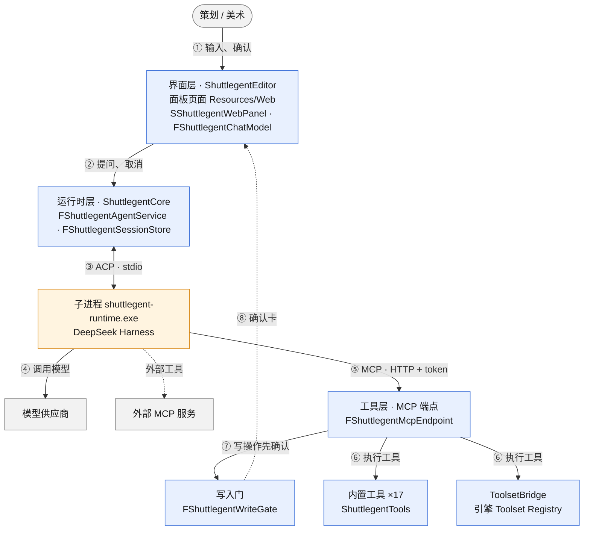
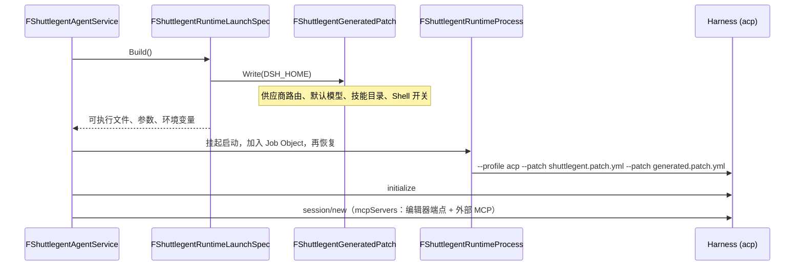
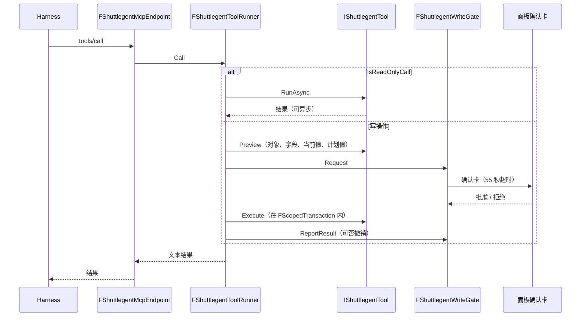
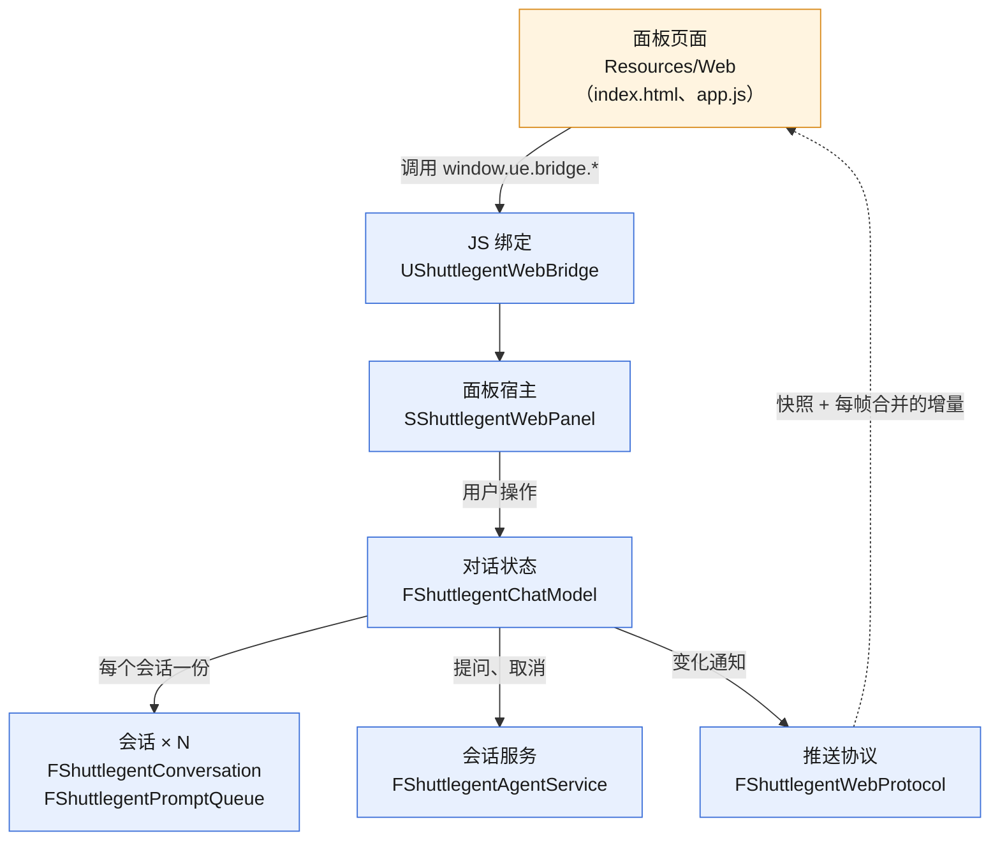

# 架构

本文说明 Shuttlegent 的组成、各部分的职责与主要流程。文中路径相对插件根目录。

## 1. 总览

Shuttlegent 由编辑器内的五个模块和一个运行时子进程组成：

- **编辑器侧**：负责对话界面、会话记录、编辑器工具与写操作确认。
- **运行时**：即 [DeepSeek Harness](https://github.com/deepseek-ai/deepseek-harness)（下称 Harness）。负责 Agent 循环、上下文管理与模型调用。

两者之间有两条通道：

- **[ACP](https://github.com/agentclientprotocol/agent-client-protocol)（Agent Client Protocol）**：编辑器作为 ACP 客户端，经子进程的 stdio 驱动 Agent。
- **MCP（Model Context Protocol）**：Agent 作为 MCP 客户端，调用编辑器内只对本机开放的 MCP 端点上的编辑器工具。

图例：蓝色为编辑器进程内的插件模块，橙色为运行时子进程，灰色为用户与外部服务；虚线为可选或回传路径。写操作先经 ⑦⑧ 在面板确认，确认后再走 ⑥ 执行。

| 层 | 模块 | 职责 |
|---|---|---|
| 运行时层 | `ShuttlegentCore` | 设置、生成运行时补丁、解析密钥、启动运行时、ACP 会话、会话记录 |
| 工具层 | `ShuttlegentMcpServer` | MCP 端点、写入门、工具注册接口 `IShuttlegentToolProvider`、外部 MCP 声明 |
| 工具层 | `ShuttlegentTools` | 17 个内置编辑器工具 |
| 工具层 | `ShuttlegentToolsetBridge` | 接入引擎 Toolset Registry |
| 界面层 | `ShuttlegentEditor` | 对话面板、对话状态、引用、斜杠模板、设置页定制；在 `PostEngineInit` 阶段加载 |

三条约束：

- 与运行时的所有通信都经过 `FShuttlegentAgentService`。
- 所有编辑器写操作都经过 `FShuttlegentWriteGate`，工具不能绕过它直接修改编辑器状态。
- 所有编辑器工具都通过 `IShuttlegentToolProvider` 注册到 MCP 端点；引擎 Toolset 只经 `ShuttlegentToolsetBridge` 接入。

## 2. 运行时与 ACP

### 2.1 运行时

`Runtime/shuttlegent-runtime.exe` 是用 `Build/BuildRuntime.ps1` 把 Harness 子模块打包成的单文件程序（Node SEA）。打包的好处：

- 用户不用装 Node；
- Node 与依赖的版本固定；
- 编辑器只需管理一个进程。

Harness 内部是插件化的：ACP 服务、Agent 核心、模型对接各是独立的插件，启动时按配置组装。`--profile acp` 选择“基础插件 + ACP 服务”这套组合。

### 2.2 启动

- **启动目录与 `DSH_HOME`**：`%LOCALAPPDATA%/Shuttlegent/dsh-home`。必须在系统盘，否则打包后的运行时加载原生模块失败。
- **进程管理**：先挂起启动，再加入关闭即终止的 Job Object，然后恢复，保证运行时及其子进程不会比编辑器活得久。
- **环境变量**：只继承必要的系统变量，再加上：
  - `DSH_HOME`、`DSH_AGENTS_HOME`；
  - `DSH_PERMISSION_MODE`（`read-only` 或 `workspace-write`）；
  - `DSH_TELEMETRY_DISABLED`；
  - 各供应商的密钥变量；
  - `SHUTTLEGENT_EDITOR_ENDPOINT`、`SHUTTLEGENT_EDITOR_TOKEN`：编辑器端点的 URL 与本次启动新生成的 token，只供插件自带的运行时插件使用（`FShuttlegentAgentService::RuntimeEnvironmentProvider`，由 `ShuttlegentMcpServer` 在启动前填入；token 每次启动运行时轮换）。
- **补丁**：
  - `Runtime/profile/shuttlegent.patch.yml`：固定的插件补丁。关闭 Shell、workflow、遥测；项目提示词只读 `SHUTTLEGENT.md`；技能只来自配置的目录；人设改为“UE 编辑器内助手”。
  - `generated.patch.yml`：每次启动前写入 `DSH_HOME`，包含用户的 DeepSeek 端点、自定义路由、默认模型、项目技能目录、Shell 开关，以及以绝对路径插入的插件自带运行时插件（见下）。补丁里不写密钥。
- **插件自带的运行时插件**（`Runtime/plugins/`，不改 Harness 源码）：
  - `shuttlegent-context-tap.mjs`：每条助手消息之后（与 `usage_update` 同一时机）读取 Harness 的 `contextBreakdown` 投影（系统提示、工具定义、消息三项估算），以 JSON-RPC 通知 `shuttlegent/contextBreakdown` 发到编辑器端点；端点交给 `FShuttlegentMcpServerModule::OnContextBreakdown()`，对话模型按会话保存后推给面板。发送失败只记一次警告，不影响对话。⚠️ 依赖 Harness 的 `session/event` 事件与 `sessionProjections` 服务，二者不是稳定接口，升级 Harness 后需用回归场景 `s14_context` 复查。
- **密钥**：只来自编辑器偏好设置，以环境变量交给运行时。内置路由用 `DEEPSEEK_API_KEY`，自定义路由用 `SHUTTLEGENT_<ROUTE>_API_KEY`。

### 2.3 会话

- `FShuttlegentAcpConnection`：基于 stdio 的 JSON-RPC 2.0，一行一条消息，回调都在游戏线程。
- `FShuttlegentAgentService`：可同时打开并驱动多个会话；一个会话的回合结束后，迟到的更新会被丢弃。
- 使用的 ACP 方法：`initialize`、`session/new`、`session/resume`、`session/close`、`session/prompt`、`session/cancel`、`session/set_config_option`（模型、思考强度）、`session/request_permission`。
- 处理的 `session/update` 类型：`agent_message_chunk`、`agent_thought_chunk`、`tool_call`、`tool_call_update`、`usage_update`。
- `FShuttlegentSessionStore`：运行时不支持 `session/load` 回放，所以每次提问、每条更新和每个回合结束都由插件追加到项目 `Saved/Shuttlegent/Sessions` 下的 JSONL 记录。重新打开会话时，由面板回放这些记录。

Harness 的 ACP 实现只暴露标准 ACP 的最小子集。待办、计划、命令、模式、上下文压缩、子任务进度和向用户提问，目前都不会传给编辑器。

## 3. 编辑器工具

### 3.1 MCP 端点

- `FShuttlegentMcpEndpoint`：只监听本机的 Streamable HTTP 端点，以普通 JSON 应答，不用 SSE。
  - 端口从 47800 起，在 100 个端口内找第一个空闲的。
  - 请求必须带 bearer token；token 在每次运行时启动时更换，通过 ACP 的 `mcpServers` 声明交给运行时。
  - 在运行时一侧，服务名为 `ue`。
- `FShuttlegentToolRegistry`：每次收到 `tools/list` 时，向所有工具提供者重新收集工具。
- 单次工具输出上限 24,000 字符，超出部分截断并提示模型缩小查询。

### 3.2 执行与写入门

写操作的规则：

- 任一对象失败时，整个事务回滚；
- 事务没有记下改动时，标为不可撤销；
- 面板未打开时，写请求直接拒绝；
- 确认超时 55 秒，短于运行时 60 秒的工具超时。

工具清单与引擎 Toolset 规则见 [Tools.md](Tools.md)。

## 4. 对话面板

- 面板是一个 Dock 页签（`ShuttlegentChat`），页面在 CEF 中加载。页签关闭后再打开，状态仍然保留。
- `FShuttlegentWebProtocol`：页面就绪时推送完整快照，此后只推增量；同一帧内的变化合并成一条消息。
- 布局：顶栏横跨对话区与检视窗格、通到面板右边缘，检视窗格开关固定在顶栏右端（打开时显示按下底色）；检视窗格位于顶栏下方，打开时把对话内容往左挤，窄宽度下改为浮层，同样位于顶栏下方。对话区的滚动容器横跨整个顶栏下方区域，滚动条贴在面板最右边缘、上下通到底，输入框浮在对话底部；停靠的检视窗格叠在对话区右侧、滚动条左边，对话内容按 `--inspector-space` 让出它的宽度。检视窗格自己的滚动条只在鼠标移入时显示。空白会话时输入框同样在底部，大标志居中于其上方的区域；输入框下方不再显示按键提示，暂不能发送的原因（排队、运行时未启动等）改写在输入框的占位文字里。
- 右侧检视窗格由四张可单独展开的卡片组成，折叠时标题行右侧显示摘要：

  | 卡片 | 摘要 | 展开内容 | 数据 |
  |---|---|---|---|
  | 上下文 | 已用百分比 | 已用与总量 tokens；分段用量条与图例：消息、工具定义、系统提示、剩余（分项按运行时估算的比例分摊实际用量，未收到分项时只显示“已用 / 剩余”）；当前模型与推理强度 | `usedTokens`、`contextSize` 来自 `usage_update`（只有总量）；`contextBreakdown` 来自运行时插件 `shuttlegent-context-tap`（见 §2.2）；`config` |
  | MCP | 下次会话可用的服务数 | 两行汇总：编辑器端点（是否监听、端口）与外部服务（已声明数、跳过数）；三组可展开明细：编辑器工具（读写与开关）、引擎 Toolset（工具数、屏蔽或关闭）、外部服务（已声明，或被跳过及原因） | `mcp`，快照时推送，个人或项目设置变化、每轮结束时重推；运行时不回报外部服务是否连上 |
  | 工具详情 | 调用次数与失败数 | 每次调用的参数与结果；点对话中的工具行时自动展开到该调用 | 对话条目 |
  | 日志 | 条数与警告数 | 运行日志 | `runLog` |

- `SShuttlegentWebPanel` 负责 CEF 管不了的部分：编辑器拖放、面板快捷键、面板自带的内容浏览器抽屉，以及用系统浏览器打开外部链接。

## 5. 类清单

路径相对 `Source/`。

| 模块 | 类 | 用途 |
|---|---|---|
| Core | `FShuttlegentAgentService` | 管理运行时与它打开的 ACP 会话 |
| Core | `FShuttlegentAcpConnection` | 基于运行时 stdio 的 JSON-RPC 2.0 连接 |
| Core | `FShuttlegentRuntimeProcess` | 运行时子进程：挂起启动、Job Object、stdio 读写线程 |
| Core | `FShuttlegentRuntimeLaunchSpec` | 组装启动所需的可执行文件、参数、环境与密钥 |
| Core | `FShuttlegentGeneratedPatch` | 每次启动前写入的第二个补丁 |
| Core | `FShuttlegentProjectConfig` / `FShuttlegentSecrets` | 读出生效配置 / 从偏好设置解析密钥 |
| Core | `FShuttlegentSessionStore` | 会话索引与 JSONL 记录 |
| Core | `FShuttlegentConsoleCommands` | `Shuttlegent.*` 控制台命令 |
| Core | `UShuttlegentSettings` / `UShuttlegentProjectSettings` | 个人设置 / 项目设置 |
| McpServer | `FShuttlegentMcpEndpoint` | 本机 MCP 端点 |
| McpServer | `FShuttlegentToolRegistry` / `FShuttlegentToolRunner` | 收集工具 / 执行一次工具调用 |
| McpServer | `FShuttlegentWriteGate` | 写操作确认门：排队、超时、结果上报、撤销 |
| McpServer | `FShuttlegentExternalMcp` | 把项目的外部 MCP 服务声明给运行时；同时给出每个服务的状态（`FShuttlegentExternalMcpState`，跳过原因为 `EShuttlegentExternalMcpIssue`），供面板 MCP 卡片显示 |
| McpServer | `IShuttlegentTool` / `IShuttlegentToolProvider` | 工具接口 / 工具提供者接口（扩展点） |
| Tools | `FShuttlegentBuiltinToolProvider` | 提供 17 个内置工具 |
| ToolsetBridge | `FShuttlegentToolsets` | 读取 Toolset Registry：可见性、工具列表、读写判断、执行 |
| Editor | `FShuttlegentChatModel` / `FShuttlegentConversation` | 对话状态 / 单个会话 |
| Editor | `SShuttlegentWebPanel` / `UShuttlegentWebBridge` / `FShuttlegentWebProtocol` | 面板宿主 / JS 绑定 / 推送协议 |
| Editor | `FShuttlegentReferenceFinder` | `@` 引用的候选与有效性 |
| Editor | `FShuttlegentTemplateLibrary` | 读取斜杠模板 |
| Editor | `FShuttlegentSettingsCustomization` | 偏好设置中的工具与 Toolset 开关 |
