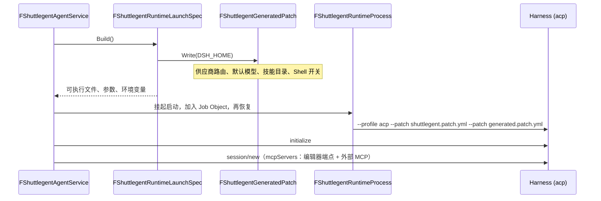
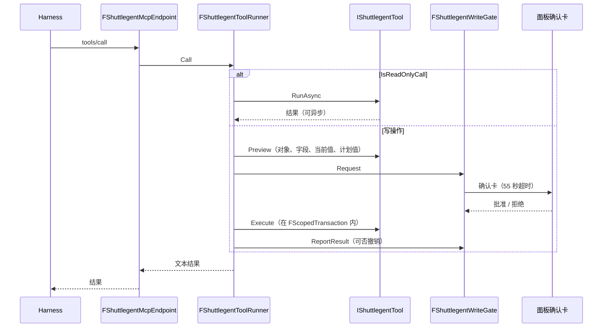
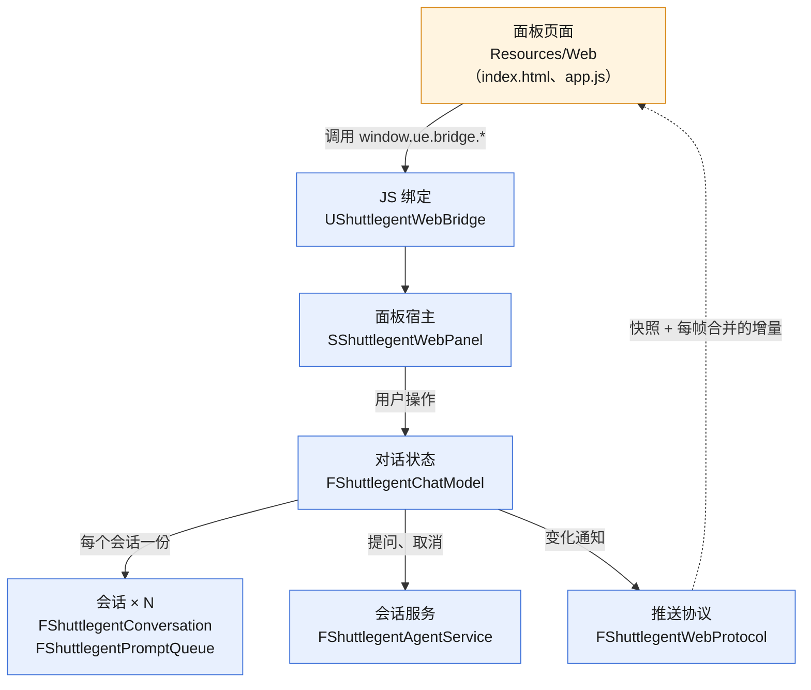

# 架构

本文说明 Shuttlegent 的组成、各部分的职责与主要流程。文中路径相对插件根目录。

## 1. 总览

Shuttlegent 由编辑器内的五个模块和一个运行时子进程组成：

- **编辑器侧**：负责对话界面、会话记录、编辑器工具与写操作确认。
- **运行时**：即 [DeepSeek Harness](https://github.com/deepseek-ai/deepseek-harness)（下称 Harness）。负责 Agent 循环、上下文管理与模型调用。

两者之间有两条通道：

- **[ACP](https://github.com/agentclientprotocol/agent-client-protocol)（Agent Client Protocol）**：编辑器作为 ACP 客户端，经子进程的 stdio 驱动 Agent。
- **MCP（Model Context Protocol）**：Agent 作为 MCP 客户端，调用编辑器内只对本机开放的 MCP 端点上的编辑器工具。

图例：蓝色为编辑器进程内的插件模块，橙色为运行时子进程，灰色为用户与外部服务；虚线为可选或回传路径。写操作先经 ⑦⑧ 在面板确认，确认后再走 ⑥ 执行。

| 层 | 模块 | 职责 |
|---|---|---|
| 运行时层 | `ShuttlegentCore` | 设置、生成运行时补丁、解析密钥、启动运行时、ACP 会话、会话记录 |
| 工具层 | `ShuttlegentMcpServer` | MCP 端点、写入门、工具注册接口 `IShuttlegentToolProvider`、外部 MCP 声明 |
| 工具层 | `ShuttlegentTools` | 内置编辑器工具，清单见 [Tools.md §2](Tools.md#2-内置工具) |
| 工具层 | `ShuttlegentToolsetBridge` | 接入引擎 Toolset Registry |
| 界面层 | `ShuttlegentEditor` | 对话面板、对话状态、引用、斜杠模板与内置斜杠命令、设置页定制；在 `PostEngineInit` 阶段加载 |

三条约束：

- 与运行时的所有通信都经过 `FShuttlegentAgentService`。
- 所有编辑器写操作都经过 `FShuttlegentWriteGate`，工具不能绕过它直接修改编辑器状态。
- 所有编辑器工具都通过 `IShuttlegentToolProvider` 注册到 MCP 端点；引擎 Toolset 只经 `ShuttlegentToolsetBridge` 接入。

## 2. 运行时与 ACP

### 2.1 运行时

`Runtime/shuttlegent-runtime.exe` 是用 `Build/BuildRuntime.ps1` 把 Harness 子模块打包成的单文件程序（Node SEA）。打包的好处：

- 用户不用装 Node；
- Node 与依赖的版本固定；
- 编辑器只需管理一个进程。

Harness 内部是插件化的：ACP 服务、Agent 核心、模型对接各是独立的插件，启动时按配置组装。`--profile acp` 选择“基础插件 + ACP 服务”这套组合。

### 2.2 启动

- **启动目录与 `DSH_HOME`**：`%LOCALAPPDATA%/Shuttlegent/dsh-home`。必须在系统盘，否则打包后的运行时加载原生模块失败。
- **进程管理**：先挂起启动，再加入关闭即终止的 Job Object，然后恢复，保证运行时及其子进程不会比编辑器活得久。
- **环境变量**：只继承必要的系统变量，再加上：
  - `DSH_HOME`、`DSH_AGENTS_HOME`；
  - `DSH_PERMISSION_MODE`（`read-only` 或 `workspace-write`）；
  - `DSH_TELEMETRY_DISABLED`；
  - 各供应商的密钥变量；
  - `SHUTTLEGENT_EDITOR_ENDPOINT`、`SHUTTLEGENT_EDITOR_TOKEN`：编辑器端点的 URL 与本次启动新生成的 token，只供插件自带的运行时插件使用（`FShuttlegentAgentService::RuntimeEnvironmentProvider`，由 `ShuttlegentMcpServer` 在启动前填入；token 每次启动运行时轮换）。
- **补丁**：
  - `Runtime/profile/shuttlegent.patch.yml`：固定的插件补丁。关闭 Shell、后台作业工具（`tool-jobs`，随 Shell 开关由生成的补丁一同打开）、切换工作目录工具（`tool-working-directory`，会把文件工具带出项目）、子任务工具（`tool-subagent`、`tool-subagent-fork`、`tool-subagent-control`、`tool-subagent-list-agents`：ACP 按会话声明编辑器端点，子会话拿不到编辑器工具，派出去的编辑器任务只会失败；回归场景 `s17_subagent`）、workflow、遥测；项目提示词只读 `SHUTTLEGENT.md`；技能只来自配置的目录；人设改为“UE 编辑器内助手”。
  - `generated.patch.yml`：每次启动前写入 `DSH_HOME`，包含内置模型的端点、由模型自动分组的路由（`FShuttlegentModelRoutes`）、默认模型、项目技能目录、Shell 开关，以及以绝对路径插入的插件自带运行时插件（见下）；Agent 分发插件存在时停用基础补丁的 `agent-loop` 行。补丁里不写密钥。
- **插件自带的运行时插件**（`Runtime/plugins/`，不改 Harness 源码）：
  - `shuttlegent-context-tap.mjs`：每条助手消息之后（与 `usage_update` 同一时机）读取 Harness 的 `contextBreakdown` 投影（系统提示、工具定义、消息三项估算），以 JSON-RPC 通知 `shuttlegent/contextBreakdown` 发到编辑器端点；端点交给 `FShuttlegentMcpServerModule::OnContextBreakdown()`，对话模型按会话保存后推给面板。发送失败只记一次警告，不影响对话。⚠️ 依赖 Harness 的 `session/event` 事件与 `sessionProjections` 服务，二者不是稳定接口，升级 Harness 后需用回归场景 `s14_context` 复查。
  - `shuttlegent-session-control.mjs`：供“回到这里”和“分支”截断会话。ACP 没有截断或分叉会话的方法，插件在本机开一个只认当前 token 的端口，加载后以通知 `shuttlegent/runtimeControl` 把 URL 报给编辑器端点（`FShuttlegentMcpServerModule::CanForkSessions()`）。编辑器调用其 `fork`（会话 ID、第几条用户消息、截在该消息之前或该轮结束之后），插件把源会话的事件截到该处，经 `sessionPersistence` 另存为一个**不带 `parentSession` 的普通会话**（Harness 自带的 `Sessions.fork` 会写入 `parentSession`，ACP 的 `session/resume` 拒绝这类会话），编辑器再用 `session/resume` 接入。用户消息只数 `source.kind` 为 `user` 的 `user/message`（运行时自己注入的运行时上下文、system-reminder 也记为 `user/message`，来源不同），与面板的用户条目一一对应；截在某条消息之前时，连同把它放进收件箱的 `agent/inbox/spliced` 一起排除，否则接入后会重新执行这条消息。复制的 `session-log-deepseek/delivery-accepted` 标记记着源会话 ID，原样复制会被存储校验判为损坏（“current-generation delivery marker names the wrong Session”），因此改标为旧格式代次，校验与 DeepSeek 投递都忽略它，新会话首次请求时重新投递完整记录。⚠️ 依赖 Harness 的 `sessions`、`sessionPersistence` 服务与事件类型名，升级后需用回归场景 `s15_fork` 复查。
    - 分支出的会话保留源会话头的 `agentPreset`，由同一个 Agent 恢复。
    - 同一端口另有五个方法（`FShuttlegentMcpServerModule` 的同名函数调用，经共用的 `CallRuntimeControl`）：
      - `nextAgent`：指定下一个新会话的 Agent（`SetNextAgent`），转给 `shuttlegent-agent-dispatch`；Agent 未安装时报错。对话模型在每个 `session/new` 之前调用，同一时间只交接一个新会话。
      - `command`：执行一条斜杠命令（`ctx.commands.execute`，与 Harness 网页客户端相同），如 `/compact`、`/plan`。ACP 的 `session/prompt` 不解析斜杠命令，会把它当普通文字发给模型，因此命令只能走这里（`RunCommand`，超时 600 秒，`/compact` 要调用模型生成摘要）。
      - `planMode`：进入或退出计划模式（`ctx.planMode.set`），不带 `active` 时只查询；回合进行中时在下一步生效（`SetPlanMode`）。
      - `answerPlanReview`：答复计划审批（`AnswerPlanReview`）。计划模式下模型调用 `exit_plan_mode` 后，Harness 经“用户提问”通道（`user-questions/request`）请用户批准，ACP 下没有任何应答方，原本直接报 `NO_PROVIDER`。插件接管其中 `intent.kind` 为 `plan-review` 的请求，以通知 `shuttlegent/planReview`（会话 ID、审批 ID、计划正文）交给编辑器，等编辑器答复批准或“继续规划 + 意见”；回合取消时发 `shuttlegent/planReviewClosed`。编辑器没有订阅 `OnPlanReview()` 时，模块直接以“不可用”退回，回合不会卡住；对话模型订阅后，交出计划的会话不在面板中时同样退回。
      - `imageInput`：某个模型路由（会话 `model` 配置项的取值）是否声明接受图片（`QueryImageInput`）。ACP 只在 `initialize` 时按默认模型声明一次图片能力，沿用旧模型或切换过模型的会话由编辑器逐个确认；解析不了的路由按不接受处理。
    - ⚠️ Harness 的计划模式只在提示词里加一段说明，**不限制工具**（`ThirdParty/deepseek-harness/packages/plan/plan-mode/src/index.ts:1-19`）；“只读”须由编辑器侧保证。
  - `shuttlegent-memory.mjs`：用系统提示词的动态上下文（`ctx.systemPrompt.context`）每次请求读取会话目录下 `Saved/Shuttlegent/` 的个人提示词 `SHUTTLEGENT.local.md` 与个人记忆 `MEMORY.md`（按修改时间缓存，单个文件超过 32 KB 跳过），文件变了从下一次请求起生效，同一会话里也是。`agent-instructions` 不接受带路径分隔符的候选文件名（`packages/context/agent-instructions/src/config.ts:132`），所以个人文件不经它加载；补丁里它只读项目根目录的 `SHUTTLEGENT.md`。不需要编辑器端点。
  - `shuttlegent-session-tap.mjs`：把 ACP 不转发的会话事件逐条按顺序以通知 `shuttlegent/sessionEvent`（会话 ID、类型、精简后的数据）发到编辑器端点，交给 `FShuttlegentMcpServerModule::OnSessionEvent()`（`FShuttlegentSessionEvent`）：

    | 事件 | 数据 |
    |---|---|
    | `todo/write` | 完整待办列表，每项 `content`、`status`（`pending`、`in_progress`、`completed`）；每次替换上一份 |
    | `plan/mode` | `active` |
    | `compaction/start`、`compaction/summary`、`compaction/end`、`compaction/prune` | `manual`（手动压缩）、`shadowedTokenCount`（被压缩掉的 token）、`error`；`compaction/end` 另带压缩后的上下文用量 `usedTokens` |
    | `goal/change` | `operation`、`objective`、`phase` |

    ⚠️ 依赖 Harness 的事件类型名与数据结构，升级后需用回归场景 `s16_session_tap` 复查。
  - `shuttlegent-agent-dispatch.mjs`：占据运行时唯一的 Agent 工厂槽位（`ctx.agents.setFactory`），让一个运行时同时承载多个循环。默认循环 `dsh-agent-loop` 经加载器导入后在分发插件之下运行，第三方循环按补丁配置中的入口模块加载（来自 `FShuttlegentAgentCatalog` 扫描的 `Runtime/plugins/agents/<id>/agent.json`）。每个循环在只隔离 `agents` 服务的作用域里运行，该作用域的 `agents` 是一个替身，记下循环注册的工厂而不占槽位，其余调用转给真实注册表，因此控制口按会话查 Agent（`agents.get`）不受影响。新会话取 `nextAgent` 指定的 Agent（只对下一个会话有效，30 秒后作废），没有指定时用默认 Agent，并把 `shuttlegent:<AgentId>` 写入会话头 `agentPreset`；带父会话的子会话沿用父会话的 Agent；恢复时按会话头分派，没有 `agentPreset` 的旧会话归默认 Agent，指向未安装的 Agent 时拒绝恢复并报错，不改用默认循环。⚠️ 依赖 Cordis 的隔离作用域与追踪层行为，升级 Harness 后需重新验证：新会话按 `nextAgent` 分派、恢复按会话头分派、子会话沿用父会话的 Agent。
- **密钥**：只来自编辑器偏好设置，以环境变量交给运行时。内置路由用 `DEEPSEEK_API_KEY`，其余路由用 `SHUTTLEGENT_<ROUTE>_API_KEY`。

### 2.3 会话

- `FShuttlegentAcpConnection`：基于 stdio 的 JSON-RPC 2.0，一行一条消息，回调都在游戏线程。
- `FShuttlegentAgentService`：可同时打开并驱动多个会话；一个会话的回合结束后，迟到的更新会被丢弃。
- 使用的 ACP 方法：`initialize`、`session/new`、`session/resume`、`session/close`、`session/prompt`、`session/cancel`、`session/set_config_option`（模型、推理强度）、`session/request_permission`。
- 处理的 `session/update` 类型：`agent_message_chunk`、`agent_thought_chunk`、`tool_call`、`tool_call_update`、`usage_update`。
- `FShuttlegentSessionStore`：运行时不支持 `session/load` 回放，所以每次提问、每条更新和每个回合结束都由插件追加到项目 `Saved/Shuttlegent/Sessions` 下的 JSONL 记录，会话列表在同目录的 `index.json`（标题、模型、Agent、写入方式、时间、是否归档）。重新打开会话时，由面板回放这些记录。

- 会话的 Agent：对话模型在发出第一条消息前可以换 Agent，之后锁定；建立会话后写入会话索引（`agent` 字段），打开已有会话以索引为准。

Harness 的 ACP 实现只暴露标准 ACP 的最小子集，待办、计划、命令、模式、上下文压缩、子任务进度和向用户提问都不经 ACP 传递，`session/new` 也带不了 Agent。插件以 `shuttlegent-session-tap`、`shuttlegent-session-control`、`shuttlegent-agent-dispatch` 三个运行时插件补上（见 §2.2）；面板已接入待办、压缩、计划模式与内置斜杠命令（见 §4）。子任务不需要接入：插件补丁关闭了子任务工具（见 §2.2），因为子会话拿不到编辑器端点。

## 3. 编辑器工具

### 3.1 MCP 端点

- `FShuttlegentMcpEndpoint`：只监听本机的 Streamable HTTP 端点，以普通 JSON 应答，不用 SSE。
  - 端口从 47800 起，在 100 个端口内找第一个空闲的。
  - 请求必须带 bearer token；token 在每次运行时启动时更换，通过 ACP 的 `mcpServers` 声明交给运行时。
  - 在运行时一侧，服务名为 `ue`。
- `FShuttlegentToolRegistry`：每次收到 `tools/list` 时，向所有工具提供者重新收集工具。
- 单次工具输出上限 24,000 字符，超出部分截断并提示模型缩小查询。

### 3.2 执行与写入门

写操作的规则：

- 任一对象失败时，整个事务回滚；
- 事务没有记下改动时，标为不可撤销；
- 面板未打开时，写请求直接拒绝；
- 确认超时 55 秒，短于运行时 60 秒的工具超时。

工具清单与引擎 Toolset 规则见 [Tools.md](Tools.md)。

## 4. 对话面板

本节只记实现。界面规范（令牌、组件、文案、新界面检查清单）见 [Design.pdf](Design.pdf)。

- 面板是一个 Dock 页签（`ShuttlegentChat`），页面在 CEF 中加载。模块生命周期内只有一个面板，页签关闭后再打开显示同一页面、状态保留。面板底层垫页面底色、浏览器开透明，拖动改变窗口大小时 CEF 晚几帧重画的区域不显示黑色。
- `FShuttlegentWebProtocol`：页面就绪时推送完整快照，此后只推增量；同一帧内的变化合并成一条消息，条目按指纹只在变化时重发。
- 用户消息的操作行：复制、回到这里、分支。
  - **分支**（`FShuttlegentChatModel::BranchFrom`）：运行时把会话截在该消息这一轮结束之后另存为新会话；面板会话记录复制到同一处，标题加“（分支）”并打开新会话。原会话与编辑器状态不变。
  - **回到这里**（`FShuttlegentChatModel::RewindTo`，页面先弹确认框，列出将撤销与不可撤销的修改数、将移除的消息数）：先确认这条消息之后可撤销写入的事务恰好依次占据撤销栈顶（`FShuttlegentWriteGate::AreOnUndoTop`），中间夹着用户自己的编辑时整体拒绝；再由运行时把会话截在该消息之前另存为新会话，成功后按倒序撤销这些写入，原会话归档，打开新会话并把消息原文放回输入框。不可撤销的写入（数据表加行、存盘等）保留在编辑器中。截断第一条消息时不需要运行时，撤销写入后开始新对话。
  - 两者都要求当前对话空闲、会话已在运行时打开、session control 插件可用（`CanEditHistory`）；不满足时按钮变灰，悬停提示原因。写入结果只保存在内存里，重新打开的旧会话回到某条消息时没有可撤销的写入。
- 处理过程：页面（`app.js` 的 `processHtml`）把一轮中最后一次工具调用之前的思考、说明文字与工具调用收为一行摘要；回合进行中这一行就是运行行。
- 排队：`FShuttlegentPromptQueue`，入队时固定文字、引用、模型与推理强度（`FShuttlegentQueuedPrompt`），发出前若引用的对象已失效则暂停；停止、被拒绝的权限、失败的回合或运行时丢失都会暂停队列，只能由用户继续。
- 任务清单：session tap 插件转来的 `todo/write`，每次替换整份列表；用户发出新提示时清空。只在内存中，不写入会话记录。
- 输入框：`Resources/Web/composer-editor.js`，基于打包进插件的 Tiptap（`Build/Editor/` 打包为 `Resources/Web/vendor/tiptap.js`）。草稿、发送内容与历史记录都是 Markdown，由它自行导出，文字原样输出、不加转义（如 `BP_Door_01`）。Ctrl+B、Ctrl+I 等面板快捷键由 `SShuttlegentWebPanel::OnPreviewKeyDown` 先截获，转成页面命令。
- 模式：手动、自动接受编辑、自动三项是 `EShuttlegentWriteMode`，按对话记在 `FShuttlegentConversation::WriteMode`，并写入会话索引（`writeMode`），重新打开、分支都沿用；只决定编辑器写入是否弹确认卡，从下一次写入起算，规则见 [Tools.md §1](Tools.md#1-写操作确认与撤销)。
- 计划模式：经 session control 插件的 `planMode` 进入或退出，会话创建前打开时先记下、会话就绪后先应用再发送第一条提示；恢复会话时查询运行时记录的状态。Harness 的计划模式只改提示词、不限制工具，只读由写入门保证：发起写入的对话处于计划模式时一律拒绝。`exit_plan_mode` 交出的计划经 `shuttlegent/planReview` 到达，审批结果经 `answerPlanReview` 答复；“批准并执行”把对话的写入方式改为自动接受编辑，“批准，逐项确认”改为手动，在 Agent 开始写入之前生效。计划与审批结果（`EShuttlegentChatEntryKind::Plan`）在审批结束时写入会话记录（`plan`）；回合取消或运行时退出时，等待中的审批标为已取消。计划模式提示词由插件补丁改成编辑器场景的说法，提问改用 `ask_user`。
- 上下文压缩：`compaction/*` 事件在对话中显示为一条分隔行（`EShuttlegentChatEntryKind::Compaction`），结束时用插件报来的压缩后用量更新上下文卡片，并把结果写入会话记录（`compaction`）。手动压缩为 `FShuttlegentChatModel::CompactContext`，经 `RunCommand` 执行 `/compact`，条件与“回到这里”相同。
- 内置斜杠命令：整段输入以下列命令开头时，由页面在编辑器侧执行，不发给模型（`Resources/Web/app.js` 的 `runSlashCommand`）；ACP 的 `session/prompt` 不解析斜杠命令，需要运行时执行的经 session control 的 `command`。其他以 `/` 开头的文字照常作为消息发送：

  | 命令 | 作用 | 复用 | 不可用时 |
  |---|---|---|---|
  | `/compact` | 压缩上下文，不带参数（与 Harness 一致） | 上下文卡片“压缩上下文”按钮 | `compactReason` |
  | `/plan`、`/plan off`、`/plan <消息>` | 进入、退出计划模式；带消息时进入后发送该消息（与 Harness 一致） | 模式菜单的“计划”；带消息时 `SubmitDraft` 的 `bEnterPlanMode` | `planModeReason` |
  | `/undo` | 回退本轮：对最后一条用户消息打开“回到这里”确认框 | “回到这里” | `editHistoryReason`；没有用户消息时说明无可回退 |
  | `/clear` | 开始新对话，当前对话留在侧栏 | 新对话 | 始终可用 |

  命令不可用或参数不对时不执行，输入保留并显示原因。`/plan <消息>`：计划模式走控制端口、提示走 ACP，两者没有先后保证，会话已打开时提示先挂起（对话随之忙碌，新草稿排队），运行时确认计划模式已开后再发出，切换失败则放回队列首位并暂停；会话未创建时沿用“就绪后先应用计划模式再发送”；回合进行中时计划模式在下一步生效，消息照常排队。
- 图片输入：粘贴由页面处理剪贴板，选图走编辑器原生文件对话框（`SShuttlegentWebPanel::HandlePickImages`），拖入文件走 Slate 的 `FExternalDragOperation`；页面把最长边缩到 2,048 像素、PNG 超过 4 MB 时转 JPEG，一条消息最多 6 张。运行时只在 `initialize` 中按默认模型声明一次图片能力（`promptCapabilities.image`），会话换过模型时编辑器经 session control 的 `imageInput` 逐个确认（按模型路由缓存，运行时重启后清空）。带图片的消息只在空闲时发送，不进队列，也不进挂起提示。图片以 ACP `image` 块发出，并按内容哈希保存到 `Saved/Shuttlegent/Sessions/Images/`，会话记录只记路径；中断后“重试”时从这里读回。
- 提醒：等待输入（写入确认、提问、计划审批、选择卡、运行时权限请求）为黄，一轮结束而用户没在看（`FShuttlegentConversation::bUnseenFinish`，用户自己停止的除外）为蓝，黄优先。页签用引擎原生色条（`SDockTab` 的 `TabColorScale`）表示：引擎没有给单个页签叠加角标的接口（图标是 `SDockTab` 内部私有的 `SImage`）。主页签取 `FShuttlegentChatModel::GetAttentionOutside`（当前对话与没有页签显示的对话），会话页签取 `FShuttlegentChatView::GetTabAttention`（只看自己的对话）；会话列表行的圆点为会话字段 `attention`。编辑器模块每 0.25 秒把各页签是否在前台告诉各自的视图（`FShuttlegentChatView::SetVisible`），对话在前台视图中即清除蓝色提醒。
- 回答中的对象链接：运行时提示词（`Runtime/profile/shuttlegent.patch.yml`）要求 Agent 把已知路径的资产写成 `[名称](ue-asset:<对象路径>)`、Actor 写成 `[Actor 标签](ue-actor:<对象路径>)`；行内代码若是完整的 `/Game/...` 路径，也渲染成资产链接。包路径（无 `.`）补上对象名，同一资产的链接路径一致。
  - 单击：资产在内容浏览器中定位，Actor 在关卡中单独选中并把关卡编辑器页签切到前台、视口获得键盘焦点；双击：打开资产编辑器，或让视口镜头移到 Actor（`FShuttlegentReferenceNavigator`，经 `UShuttlegentWebBridge::RevealObject`）。只改选中与焦点，不产生事务，不影响“回到这里”。
  - 拖入输入框：按住链接移动超过 5 像素即开始拖动，松开在输入框上时成为草稿引用标签，与 `@` 或从内容浏览器拖入的引用相同。CEF 不运行 HTML 原生拖放，页面用鼠标事件实现；松开后经 `UShuttlegentWebBridge::AddObjectReference` 交编辑器按路径补全类与名称（`FShuttlegentReferenceFinder::TryResolve`），再经 `onDrop` 加入草稿，对象已不存在时不加。拖动不触发单击定位。
  - 存在性：页面把对话中全部对象链接与草稿引用一起交给 `WatchReferences`，对象被删除或经撤销恢复后，链接随 `onReferenceValidity` 变灰（加删除线，悬停提示“对象已不存在”），点击不做任何操作。
  - Actor 只认 Agent 明确写出的链接，页面不按名称猜测，避免重名时选错对象。
  - 表格渲染为 HTML 表格，单元格内同样解析链接、行内代码与加粗（`Resources/Web/markdown.js` 的 `table`）；分隔行到达前（回答仍在流式输出）按等宽源码显示。
- 回答中的图片：`` 只认三种来源，其他 src 按原文显示（`markdown.js` 的 `parseImage`）。
  - `ue-asset:<对象路径>`：资产缩略图，可加 `?size=64|128|256`（默认 128）。每条回答先显示 24 张，超出的以灰色小字对象链接排在图片之后，下方一行“另有 N 个资产未显示缩略图 · 显示下 N 张”，每按一次再多显示 24 张（`app.js` 的 `thumbnailLimits`，打开会话时清空）。说明文字就是对象链接，单击定位、双击打开，资产被删除后照样变灰。
  - 本机图片：`Saved/Shuttlegent/` 下的 png/jpg/jpeg/webp/gif，可写相对项目的 `Saved/Shuttlegent/...`，也可写工具返回的绝对路径。含 `..`、`.`、`%`、`?`、`#` 或不在该目录下的路径一律不显示。目录的 `file:///` 地址随快照下发（`localImageRoot`）。
  - 网络图片：`http(s)://`，带 `referrerpolicy="no-referrer"` 与 `loading="lazy"` 直接加载（面板没有 CSP，`SShuttlegentWebPanel` 只拦截整页跳转）。加载失败显示“图片加载失败”与原链接，点击链接用系统浏览器打开。
  - 缩略图按需抓取：页面渲染后把还没有取过的资产路径经 `UShuttlegentWebBridge::RequestThumbnails`（JSON 数组，每次最多 24 个）交给编辑器。`FShuttlegentAssetThumbnails` 排队，每个 Core Ticker tick 取一张，按顺序尝试 `ThumbnailTools::FindCachedThumbnail`（内存）→ `LoadThumbnailFromPackage`（读 .uasset，不加载资产）→ `RenderThumbnail`（同步加载后以 256 像素现渲染，`NeverFlush`，不等待流送与着色器编译）。现渲染前先经 `UThumbnailManager::GetRenderingInfo` 问渲染器 `CanVisualizeAsset`，画不出的资产（没有可见组件的蓝图、没捕获缩略图的 Niagara 系统）按取不到处理，否则只会得到清屏的纯黑图。取到的图补成不透明，编成 PNG data URL，经 `onThumbnails({ 路径: dataUrl | null })` 逐张回传。Output Log 的 `Shuttlegent thumbnail:` 行写明每张的来源。
  - 页面按路径缓存缩略图，回答流式重绘时直接用缓存，不会闪烁；打开会话（完整快照）时清空，重新抓取。取不到时显示“无缩略图”。
- 选择卡（`ask_choices`）：Agent 需要用户挑图、配色、选材质、对比方案或逐条批注时调用。
  - 运行时对编辑器工具调用固定 60 秒超时（Harness `mcp-client` 的 `DEFAULT_TOOL_CALL_TIMEOUT_MS`，ACP 声明服务器时不能改），写评语不够用，所以选择卡不等待作答：工具把卡片交给 `FShuttlegentQuestionGate::PresentChoice` 后立即返回，提示 Agent 结束本轮；没有面板时返回失败说明，Agent 改在回复里列出选项。
  - 对话模型把卡片放进正在运行回合的对话（当前对话优先），条目类型 `EShuttlegentChatEntryKind::Choice`，同一对话只保留一张等待中的卡片。卡片内容与提交结果按 `FShuttlegentChoiceJson` 的形状写进会话记录（`choice`，出现与结束各记一条，回放以最后一条为准），重开会话后照样显示；重开时仍在等待的卡片已没有回合在等它，标为“未作答”。
  - 提交经 `UShuttlegentWebBridge::SubmitChoice` 交给 `FShuttlegentChatModel::SubmitChoice`：卡片标为已提交，选择整理成一条用户消息走 `SubmitDraft` 发出，本轮仍在运行时进入队列；被拒绝时经 `onChoiceRejected` 把原因显示在卡片上。卡片上的草稿按条目保存在页面，重绘不丢。
  - 用户直接发了别的消息，卡片标为“未作答”；交出卡片的回合被停止，卡片标为“已取消”。页面把选择卡挪到所在一轮的末尾，这一轮的处理过程不被卡片切开。
- 标志与动效：`mark.js` 按 `brand-geometry.js`（`Build/Brand/` 导出）以内联 SVG 绘制标志，背景经线为 `warp.js`；运行行的织动动画为 `app.css` 的 `sg-weave-*`，全部共用一个相位。Animate Mark 关闭、系统要求减少动态效果或页签不可见时全部静止。
- 检视窗格的数据来源：

  | 卡片 | 数据 |
  |---|---|
  | 上下文 | `usedTokens`、`contextSize` 来自 `usage_update`（只有总量）；分项 `contextBreakdown` 来自运行时插件 `shuttlegent-context-tap`（见 §2.2），按运行时估算的比例分摊实际用量；`config` |
  | MCP | `mcp`：快照时推送，个人或项目设置变化、每轮结束时重推；运行时不回报外部服务是否连上 |
  | 记忆 | `memory`（`FShuttlegentMemoryStore`）；面板重新获得焦点时重读文件 |
  | 工具详情 | 对话条目 |
  | 日志 | `runLog` |

- 记忆：`remember`、`forget` 的调用不显示为工具行，改为一行可撤销的提示（`FShuttlegentMemoryStore::Revert`，记忆已被别处改动时说明原因）；这些提示不写入会话记录。
- 会话页签：
  - 视图与对话：每个页签（主页签与各会话页签）一个 `FShuttlegentChatView`，持有它显示的对话，把面板的读取与操作转给 `FShuttlegentChatModel`；模型同时持有多个对话，没有视图显示且空闲的对话被释放。写入确认、提问与选择卡按会话声明的 `X-Shuttlegent-Conversation` 请求头归属发起它的对话。
  - 拖出：只能从主页签会话列表按住一行拖出（`UShuttlegentWebBridge::BeginSessionDrag`）。`FShuttlegentSessionTabRegistry` 在关卡编辑器的页签管理器中注册类型名为 `ShuttlegentSession.<ViewId>` 的 `PanelTab`，开一个藏在光标外的浮动窗口，等页签排版完成后交给引擎原生的页签拖拽，因此能与 Details、Outliner、视口互相停靠与叠放，进不了顶部大页签栏。一个会话只在一处显示，列表点击已在页签中的会话即跳到该页签。前台是会话页签的浮动窗口以会话标题为窗口标题。
  - 重启恢复：页签位置随关卡编辑器布局保存；`ViewId` 与会话的绑定、主页签当前会话存在个人配置（节 `ShuttlegentPanel`，键 `SessionTabs`、`HubSessionId`），关卡编辑器恢复布局前（`OnRegisterTabs`）按绑定注册 Spawner 接回。恢复出的会话只回放记录，第一次到前台或发送时才 `session/resume`。
  - 草稿与队列：`FShuttlegentDraftStore` 把每个会话的草稿（页面经 `SaveDraft` 交来的文字、引用、图片）与排队消息存到 `Saved/Shuttlegent/Sessions/Drafts/<SessionId>.json`，新对话的草稿按视图存在 `Drafts/Views/`。切换会话、会话移进页签、页面重新载入时由协议的 `draft` 字段放回；排队消息在打开会话时放回并暂停，不自动发送。删除会话时一并删除。
  - 中断：关闭编辑器时有回合在进行，先弹确认并列出会话（`IMainFrameModule::RegisterCanCloseEditor`），确认后等待中的计划记为已取消、选择卡记为未作答、权限请求记为拒绝。回放会话记录时，只有 `prompt` 而没有 `turn_end` 的一轮显示“这一轮没有正常结束”；是最后一轮时提供“重试”，原消息的图片从会话图片目录读回。
- `SShuttlegentWebPanel` 负责 CEF 管不了的部分：编辑器拖放、面板快捷键、面板自带的内容浏览器抽屉，以及用系统浏览器打开外部链接（只有 `http(s)` 链接交给系统浏览器，对象链接由页面拦截后经桥接处理）。

## 5. 类清单

路径相对 `Source/`。

| 模块 | 类 | 用途 |
|---|---|---|
| Core | `FShuttlegentAgentService` | 管理运行时与它打开的 ACP 会话 |
| Core | `FShuttlegentAcpConnection` | 基于运行时 stdio 的 JSON-RPC 2.0 连接 |
| Core | `FShuttlegentRuntimeProcess` | 运行时子进程：挂起启动、Job Object、stdio 读写线程 |
| Core | `FShuttlegentRuntimeLaunchSpec` | 组装启动所需的可执行文件、参数、环境与密钥 |
| Core | `FShuttlegentGeneratedPatch` | 每次启动前写入的第二个补丁 |
| Core | `FShuttlegentProjectConfig` / `FShuttlegentSecrets` | 读出生效配置 / 从偏好设置解析密钥 |
| Core | `FShuttlegentModelRoutes` | 由模型推出运行时路由：分组、路由名、密钥沿用、默认模型 |
| Core | `FShuttlegentModelProbe` | 检测连接：按协议发最小请求并分类结果 |
| Core | `FShuttlegentAgentCatalog` | 可用 Agent 的目录：默认循环与 `Runtime/plugins/agents/<id>/agent.json` 声明的循环插件 |
| Core | `FShuttlegentSettingsMigration` | 旧版供应商设置一次性迁移到模型、Agent、默认值 |
| Core | `FShuttlegentSessionStore` | 会话索引与 JSONL 记录 |
| Core | `FShuttlegentConsoleCommands` | `Shuttlegent.*` 控制台命令 |
| Core | `UShuttlegentSettings` / `UShuttlegentProjectSettings` | 个人设置 / 项目设置 |
| McpServer | `FShuttlegentMcpEndpoint` | 本机 MCP 端点 |
| McpServer | `FShuttlegentToolRegistry` / `FShuttlegentToolRunner` | 收集工具 / 执行一次工具调用 |
| McpServer | `FShuttlegentWriteGate` | 写操作确认门：排队、超时、结果上报、撤销 |
| McpServer | `FShuttlegentExternalMcp` | 把项目的外部 MCP 服务声明给运行时；同时给出每个服务的状态（`FShuttlegentExternalMcpState`，跳过原因为 `EShuttlegentExternalMcpIssue`），供面板 MCP 卡片显示 |
| McpServer | `IShuttlegentTool` / `IShuttlegentToolProvider` | 工具接口 / 工具提供者接口（扩展点） |
| Tools | `FShuttlegentBuiltinToolProvider` | 提供内置工具（清单见 [Tools.md §2](Tools.md#2-内置工具)） |
| ToolsetBridge | `FShuttlegentToolsets` | 读取 Toolset Registry：可见性、工具列表、读写判断、执行 |
| Editor | `FShuttlegentChatModel` / `FShuttlegentConversation` | 对话状态：同时持有多个对话，写入、提问按对话归属 / 单个对话 |
| Editor | `FShuttlegentChatView` | 一个页签的对话视图：持有它显示的对话，转发模型接口与事件 |
| Editor | `FShuttlegentSessionTabRegistry` | 会话页签：拖出、注册与接回、前台状态、绑定写入个人配置 |
| Editor | `FShuttlegentDraftStore` | 会话草稿与排队消息的存盘 |
| Editor | `SShuttlegentWebPanel` / `UShuttlegentWebBridge` / `FShuttlegentWebProtocol` | 面板宿主 / JS 绑定 / 推送协议 |
| Editor | `FShuttlegentReferenceFinder` | `@` 引用的候选与有效性 |
| Editor | `FShuttlegentReferenceNavigator` | 回答中对象链接的点击：在内容浏览器定位或打开资产，在关卡中选中 Actor 或让视口移到它 |
| Editor | `FShuttlegentTemplateLibrary` | 读取斜杠模板 |
| Editor | `FShuttlegentSettingsCustomization` | 偏好设置中的工具与 Toolset 开关、默认 Agent 与默认模型下拉 |
| Editor | `FShuttlegentModelEntryCustomization` / `FShuttlegentAgentEntryCustomization` / `SShuttlegentProbeRow` | 模型条目 / Agent 条目的设置页显示 / 检测连接行 |
