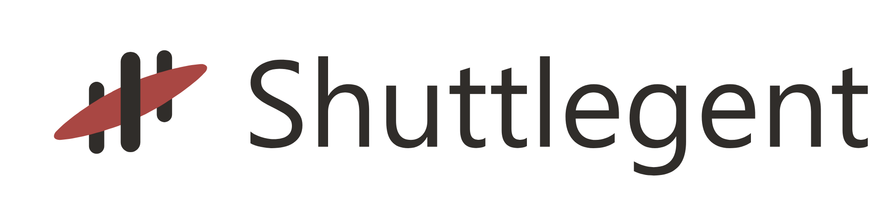

  <picture>
    <source media="(prefers-color-scheme: dark)" srcset="Resources/png/lockup-horizontal-red-white.png">
    
  </picture>

<b>Unreal Editor 内 AI 助手</b>

  
  
  
  

Shuttlegent 是停靠在 Unreal Editor 里的 AI 助手，面向设计师和美术。

- **模式**：每次要改东西，先列出对象和改前改后的值，你确认后才执行，执行后可以撤销。
- **Unreal Engine Editor**：可以直接引用选中的 Actor，或把资产从内容浏览器拖进对话；回答里的对象名点一下就能定位。
- **多会话**：多个会话同时进行，每个会话都能拖成独立窗口，和 Details、Outliner 一样停靠。
- **模型**：默认使用 DeepSeek，也可以接入 OpenAI 协议、Anthropic 协议的模型，或团队网关、本地模型服务。
- **引擎工具**：通过 UE 5.8 的 Toolset Registry 使用 UMG、Niagara、PCG、GameplayTags、StateTree 等系统的工具。

## 快速开始

### 1. 准备

- Windows 上的 Unreal Engine 5.8。
- 一个模型 API 密钥，默认使用 [DeepSeek](https://platform.deepseek.com/)。

### 2. 安装插件

1. 把本仓库放进项目的 `Plugins/Shuttlegent` 目录。
2. 准备运行时 `Runtime/shuttlegent-runtime.exe`。预编译版本尚未发布，目前需要自行构建，见 [Docs/Development.md §2](Docs/Development.md#2-构建运行时)。
3. 在项目的 `.uproject` 中启用 `Shuttlegent` 插件（默认不启用），重新生成工程文件并编译编辑器。

### 3. 填写密钥

打开 **编辑器偏好设置 > Shuttlegent > General > Models**，给默认模型填写 Api Key（内置的两个 DeepSeek 模型共用一个密钥），再点该模型的“检测连接”确认能连通。添加其他模型、更换默认模型见 [Docs/Configuration.md](Docs/Configuration.md)。

### 4. 开始对话

菜单 **窗口 > Shuttlegent** 打开面板，输入要做的事，按 Enter 发送。

- 输入 `@` 可以引用 Actor 和资产，也可以从内容浏览器、大纲视图直接拖进输入框；截图可以直接粘贴。
- 回合进行中继续发的消息会排队，本轮结束后发出；当前回合随时可以停止。
- 想先看方案再动手，在输入框下方的模式按钮里切到“计划”。

### 5. 启用引擎 Toolset（可选）

在 **编辑 > 插件** 中搜索 Toolset，按需启用（如 EditorToolset、UMGToolSet、NiagaraToolsets、PCGToolset），然后重启编辑器。推荐清单见 [Docs/Tools.md §3.1](Docs/Tools.md#31-启用-toolset)。

## 安全与控制

- **改动**：确认卡 55 秒内没有确认视为放弃；面板没打开时，改动请求直接被拒绝。也可以按会话切换为“自动接受编辑”等模式，见 [Docs/Tools.md §1](Docs/Tools.md#1-改动的确认与撤销)。
- **撤销**：改动在编辑器事务中执行，任一对象失败就整批回滚；存盘等不能撤销的操作会在确认卡上标明。
- **能力**：写代码、开关插件、模拟界面点击等引擎 Toolset 默认屏蔽；每个工具和 Toolset 都可以单独关闭。
- **密钥**：密钥保存在本机的编辑器偏好设置中，不进版本库。

## 文档

| 文档 | 给谁看 | 内容 |
|---|---|---|
| [Configuration.md](Docs/Configuration.md) | 使用者、项目负责人 | 模型、Agent、权限、工具开关、项目设置 |
| [Tools.md](Docs/Tools.md) | 使用者 | Agent 能用哪些工具，改动怎么确认和撤销，引擎 Toolset 怎么启用 |
| [Extending.md](Docs/Extending.md) | 项目负责人、技术美术 | 项目提示词、技能、模板、界面指路、外部服务、自定义工具 |
| [FAQ.md](Docs/FAQ.md) | 使用者 | 常见问题 |
| [Architecture.md](Docs/Architecture.md) | 开发者 | 模块组成、运行时与协议、编辑器工具端点、面板实现 |
| [Development.md](Docs/Development.md) | 开发者 | 仓库结构、构建运行时、编译、回归测试、排查 |
| [Design.pdf](Docs/Design.pdf) | 设计、开发者 | 界面设计规范：品牌、视觉、组件、交互模式与新界面检查清单 |

## 工作原理

面板里的对话由一个后台运行时（基于 [DeepSeek Harness](https://github.com/deepseek-ai/deepseek-harness)）驱动，它负责与模型对话、规划步骤。编辑器通过 [ACP](https://github.com/agentclientprotocol/agent-client-protocol) 与运行时通信；运行时需要查看或改动编辑器时，通过 [MCP](https://modelcontextprotocol.io/) 调用编辑器里只对本机开放的工具，改动回到编辑器确认后才执行。详见 [Docs/Architecture.md](Docs/Architecture.md)。

## 许可

[MIT](LICENSE)。子模块 `ThirdParty/deepseek-harness` 遵循其自身的许可。

## 致谢

- [DeepSeek Harness](https://github.com/deepseek-ai/deepseek-harness)：Agent 运行时
- [Agent Client Protocol](https://github.com/agentclientprotocol/agent-client-protocol)：编辑器与 Agent 之间的协议
- [Model Context Protocol](https://modelcontextprotocol.io/)：Agent 调用编辑器工具的协议
