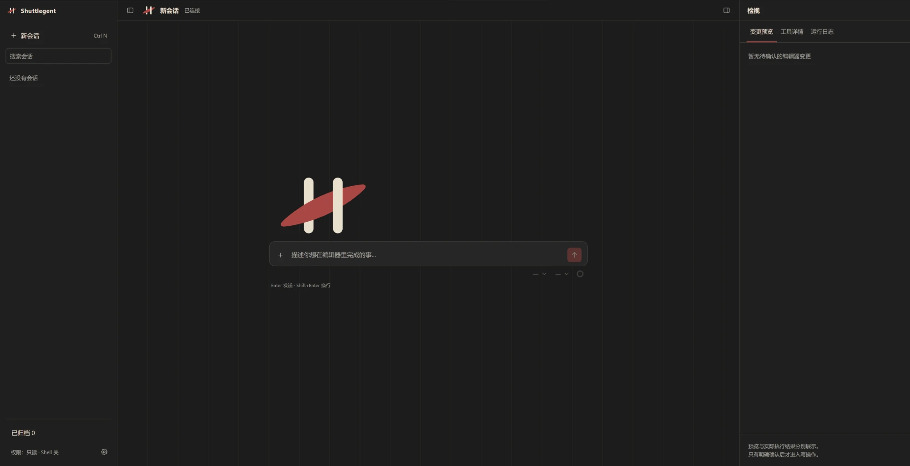

  <picture>
    <source media="(prefers-color-scheme: dark)" srcset="Resources/png/lockup-horizontal-red-white.png">
    
  </picture>

<b>Unreal Editor 内 AI 助手</b>

  
  
  
  

在编辑器内完成关卡、Actor、资产和设置上的操作：查询、修改、摆放、整理。Agent 的每一项改动均先向用户展示，经确认后执行，执行后可撤销。

- **编辑器内集成**：面板停靠于编辑器，可直接引用选中的 Actor，或从内容浏览器将资产拖入对话。
- **改动需确认**：每次写操作先弹出确认卡，列出对象、字段、当前值与计划值；确认后在编辑器事务中执行，可撤销。
- **模型可选**：默认使用 DeepSeek，亦可接入 OpenAI 协议、Anthropic 协议、团队网关或本地模型服务。
- **接入引擎 AI 工具**：通过 UE 5.8 的 Toolset Registry 使用 UMG、Niagara、PCG、GameplayTags、StateTree 等系统的工具。

名称取自织机上的梭子（shuttle）：梭子携纬线在经线之间往返穿梭，Shuttlegent 在编辑器与 Agent 之间往返传递请求、工具调用与结果。

## 使用示例

| 用户请求 | 执行过程 |
|---|---|
| 将选中灯光的强度统一调整为 5000 | 读取各灯光的当前强度，在确认卡中列出修改前后的值，确认后一次完成 |
| 列出关卡中仍使用默认名称的 Actor | 列出标签仍为默认名称的 Actor，不做修改 |
| 查询引用 Hero 角色资产的位置 | 列出引用该资产的资产与关卡 |
| 在玩家出生点附近放置一个点光源 | 定位出生点，生成点光源，执行前确认 |
| 项目的抗锯齿方法在何处设置 | 给出当前设置，并打开对应的设置页 |
| 为当前界面添加一个确认按钮 | 通过 UMG Toolset 修改控件蓝图，执行前确认（需启用 UMGToolSet） |
| 撤销上一步操作 | 列出将撤销的步骤，确认后撤销 |

## 快速开始

### 1. 环境要求

- Unreal Engine 5.8，Windows
- 模型 API 密钥，默认使用 [DeepSeek](https://platform.deepseek.com/)

### 2. 安装插件

1. 将本仓库放入项目的 `Plugins/Shuttlegent` 目录。
2. 准备运行时 `Runtime/shuttlegent-runtime.exe`。预编译版本尚未发布，目前需自行构建，见 [Docs/Development.md §2](Docs/Development.md#2-构建运行时)。
3. 在项目的 `.uproject` 中启用 `Shuttlegent` 插件（默认不启用），重新生成工程文件并编译编辑器。

### 3. 配置密钥

在 **编辑器偏好设置 > Shuttlegent > General > Providers** 中填写 DeepSeek Api Key。其他供应商的配置见 [Docs/Configuration.md](Docs/Configuration.md)。

### 4. 开始对话

通过 **窗口 > Shuttlegent** 打开面板，输入任务后按 Enter 发送。

- 输入 `@`、按 Ctrl+Space，或从内容浏览器、大纲视图拖入，可引用 Actor 与资产。
- 输入 `/` 可选择项目提供的模板。
- 回合进行中发送的消息进入队列；当前回合可随时停止。

### 5. 启用引擎 Toolset（可选）

在 **编辑 > 插件** 中搜索 Toolset，按需启用（如 EditorToolset、UMGToolSet、NiagaraToolsets、PCGToolset），然后重启编辑器。推荐清单见 [Docs/Tools.md §3.1](Docs/Tools.md#31-启用-toolset)。

## 安全与控制

- **写操作逐次确认**：面板未打开时，写请求直接拒绝；确认卡 55 秒内未确认视为放弃。
- **可撤销**：写操作在编辑器事务中执行，任一对象失败时整批回滚；不可撤销的操作（如保存）在确认卡中标明。
- **运行时默认只读**：Agent 的文件与命令行能力默认关闭或受限，仅能通过编辑器工具改动项目。
- **高风险能力默认屏蔽**：写代码、开关插件、模拟界面点击等引擎 Toolset 默认屏蔽；每个工具与 Toolset 均可单独关闭。
- **密钥仅存本机**：密钥保存在本机的编辑器偏好设置中，不进入版本库，不写入补丁文件。

## 功能

| 类别 | 内容 |
|---|---|
| 对话面板 | 多会话并行、会话搜索与归档、消息队列、思考过程折叠、用量显示、模型与思考强度切换 |
| 内置工具 | 关卡、资产、反射、诊断、编辑、撤销重做、界面指路，共 17 个，见 [Docs/Tools.md §2](Docs/Tools.md#2-内置工具) |
| 引擎 Toolset | 通过 `list_toolsets`、`describe_toolset`、`call_toolset_tool` 使用已启用的 Toolset，见 [Docs/Tools.md §3](Docs/Tools.md#3-引擎-toolset) |
| 模型 | DeepSeek（默认）、OpenAI 协议、Anthropic 协议、OpenAI 兼容端点 |
| 项目扩展 | 项目提示词、技能、斜杠模板、界面指路、外部 MCP 服务、自定义工具，见 [Docs/Extending.md](Docs/Extending.md) |

## 文档

| 文档 | 内容 |
|---|---|
| [Configuration.md](Docs/Configuration.md) | 模型与密钥、权限、工具开关、项目设置 |
| [Tools.md](Docs/Tools.md) | 写操作确认与撤销、内置工具、引擎 Toolset |
| [Extending.md](Docs/Extending.md) | 项目提示词、技能、模板、界面指路、外部 MCP、自定义工具 |
| [Architecture.md](Docs/Architecture.md) | 模块组成、运行时与 ACP、MCP 端点、对话面板 |
| [Development.md](Docs/Development.md) | 仓库结构、构建运行时、编译、回归测试、排查 |
| [FAQ.md](Docs/FAQ.md) | 常见问题 |

## 架构概览

Shuttlegent 由编辑器内的五个模块与一个运行时子进程组成：

- **Agent 底座**：[DeepSeek Harness](https://github.com/deepseek-ai/deepseek-harness)，以子进程方式运行，负责 Agent 循环、上下文管理与模型调用。
- **编辑器与 Agent**：编辑器通过 [ACP](https://github.com/agentclientprotocol/agent-client-protocol)（Agent Client Protocol）驱动 Agent。
- **Agent 与编辑器工具**：Agent 通过 MCP 调用编辑器内仅限本机访问的端点；写操作回到编辑器确认后执行。

详见 [Docs/Architecture.md](Docs/Architecture.md)。

## 许可

[MIT](LICENSE)。子模块 `ThirdParty/deepseek-harness` 遵循其自身的许可。

## 致谢

- [DeepSeek Harness](https://github.com/deepseek-ai/deepseek-harness)：Agent 运行时
- [Agent Client Protocol](https://github.com/agentclientprotocol/agent-client-protocol)：编辑器与 Agent 之间的协议
- [Model Context Protocol](https://modelcontextprotocol.io/)：Agent 调用编辑器工具的协议
