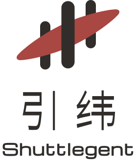
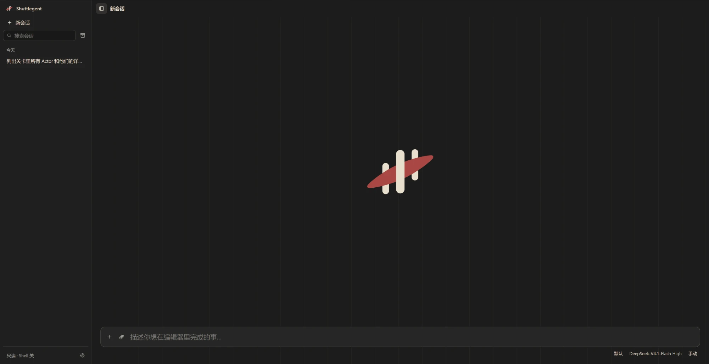
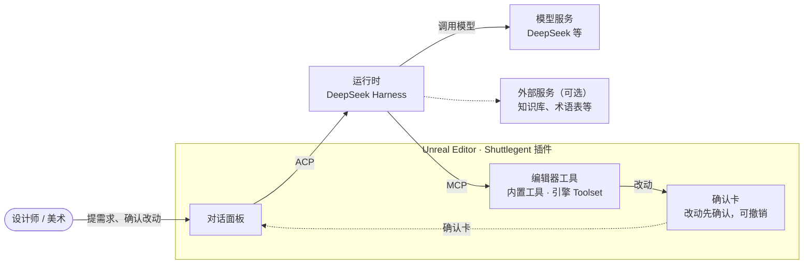

  <picture>
    <source media="(prefers-color-scheme: dark)" srcset="Resources/svg/lockup-name-red-white.svg">
    
  </picture>

<b>Unreal Editor 内 AI 助手</b>

  
  
  
  

<a href="https://jiajiaju.github.io/shuttlegent-site/docs/">完整文档</a>

Shuttlegent 是停靠在 Unreal Editor 里的 AI 助手，面向设计师和美术。

- **模式**：每次要改东西，先列出对象和改前改后的值，你确认后才执行，执行后可以撤销。
- **Unreal Engine Editor**：可以直接引用选中的 Actor，或把资产从内容浏览器拖进对话；回答里的对象名点一下就能定位。
- **多会话**：多个会话同时进行，每个会话都能拖成独立窗口，和 Details、Outliner 一样停靠。
- **模型**：默认使用 DeepSeek，也可以接入 OpenAI 协议、Anthropic 协议的模型，或团队网关、本地模型服务。
- **引擎工具**：通过 UE 5.8 的 Toolset Registry 使用 UMG、Niagara、PCG、GameplayTags、StateTree 等系统的工具。

## 快速开始

### 1. 准备

- Windows 上的 Unreal Engine 5.8。
- 一个模型 API 密钥，默认使用 [DeepSeek](https://platform.deepseek.com/)。

### 2. 安装插件

1. 从 [Releases](https://github.com/Jiajiaju/Shuttlegent/releases) 下载插件包 `Shuttlegent-<版本>-UE5.8-win64.zip`，解压到项目的 `Plugins/` 目录，得到 `Plugins/Shuttlegent`。插件包已自带运行时，不需要另外构建。
2. 在项目的 `.uproject` 中启用 `Shuttlegent` 插件（默认不启用），重新生成工程文件并编译编辑器。

直接 clone 本仓库得到的是源码，不含运行时；要用 clone 的源码，需要先自行构建运行时，见 [开发文档 §2](https://jiajiaju.github.io/shuttlegent-site/docs/?p=Development#2-构建运行时)。

### 3. 填写密钥

最简单的办法：打开面板（主工具栏播放按钮右侧的 Shuttlegent 标志按钮），在“连接一个模型”卡片里选 DeepSeek 填密钥，或选其他服务填地址和密钥，点“连接”。

也可以打开 **编辑器偏好设置 > Shuttlegent > General > Models**，给内置的 DeepSeek 连接填写 Api Key；要用其他服务，就添加一条连接，只填 Base Url 和 Api Key。协议和可用模型会自动检测，Status 显示 Connected 即可使用。详见 [配置文档](https://jiajiaju.github.io/shuttlegent-site/docs/?p=Configuration)。

### 4. 开始对话

点主工具栏播放按钮右侧的 Shuttlegent 标志按钮打开面板，输入要做的事，按 Enter 发送。

- 输入 `@` 可以引用 Actor 和资产，也可以从内容浏览器、大纲视图直接拖进输入框；截图可以直接粘贴。
- 回合进行中继续发的消息会排队，本轮结束后发出；当前回合随时可以停止。
- 想先看方案再动手，在输入框下方的模式按钮里切到“计划”。

### 5. 启用引擎 Toolset（可选）

在 **编辑 > 插件** 中搜索 Toolset，按需启用（如 EditorToolset、UMGToolSet、NiagaraToolsets、PCGToolset），然后重启编辑器。推荐清单见 [工具文档 §3.1](https://jiajiaju.github.io/shuttlegent-site/docs/?p=Tools#31-启用-toolset)。

## 安全与控制

- **改动**：确认卡 55 秒内没有确认视为放弃；面板没打开时，改动请求直接被拒绝。也可以按会话切换为“自动接受编辑”等模式，见 [工具文档 §1](https://jiajiaju.github.io/shuttlegent-site/docs/?p=Tools#1-改动的确认与撤销)。
- **撤销**：改动在编辑器事务中执行，任一对象失败就整批回滚；存盘等不能撤销的操作会在确认卡上标明。
- **能力**：写代码、开关插件、模拟界面点击等引擎 Toolset 默认屏蔽；每个工具和 Toolset 都可以单独关闭。
- **密钥**：密钥保存在本机的编辑器偏好设置中，不进版本库。

## 工作原理

Shuttlegent 由编辑器里的插件和一个后台运行时组成：

- **插件**：提供对话面板，管理会话，执行编辑器工具；所有改动都先经确认卡，确认后在编辑器事务里执行。
- **运行时**：基于 [DeepSeek Harness](https://github.com/deepseek-ai/deepseek-harness)，随插件一起提供，负责与模型对话、规划步骤、决定调用哪个工具。

两者之间有两条通道：编辑器通过 [ACP](https://github.com/agentclientprotocol/agent-client-protocol) 驱动运行时；运行时通过 [MCP](https://modelcontextprotocol.io/) 调用编辑器里只对本机开放的工具。

详见 [架构文档](https://jiajiaju.github.io/shuttlegent-site/docs/?p=Architecture)。

## 许可

[MIT](LICENSE)。子模块 `ThirdParty/deepseek-harness` 遵循其自身的许可。

## 致谢

- [DeepSeek Harness](https://github.com/deepseek-ai/deepseek-harness)：Agent 运行时
- [Agent Client Protocol](https://github.com/agentclientprotocol/agent-client-protocol)：编辑器与 Agent 之间的协议
- [Model Context Protocol](https://modelcontextprotocol.io/)：Agent 调用编辑器工具的协议
